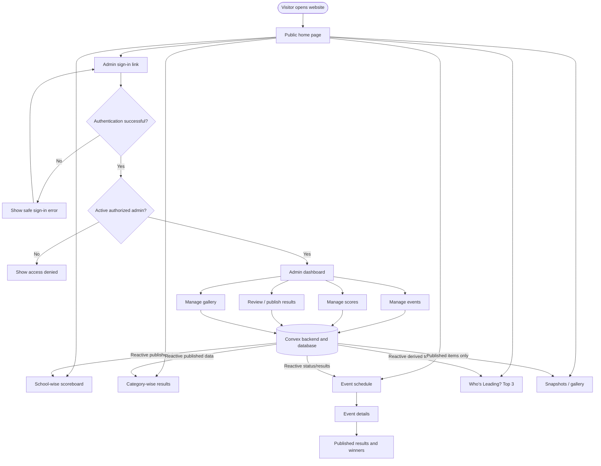
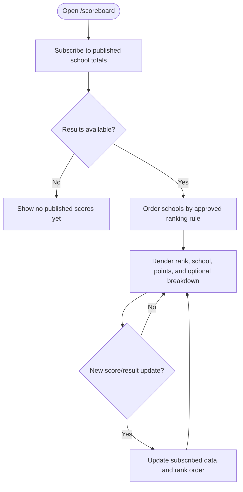
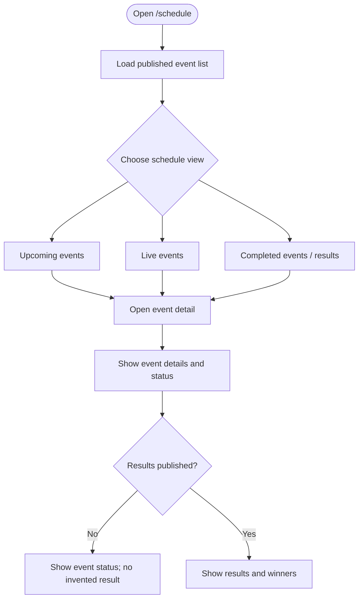
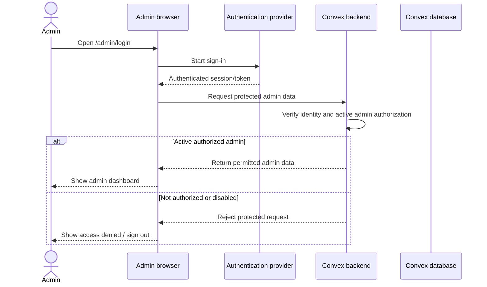
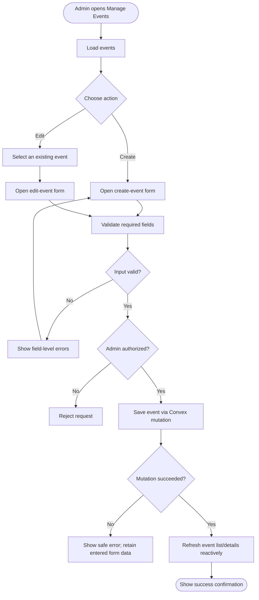
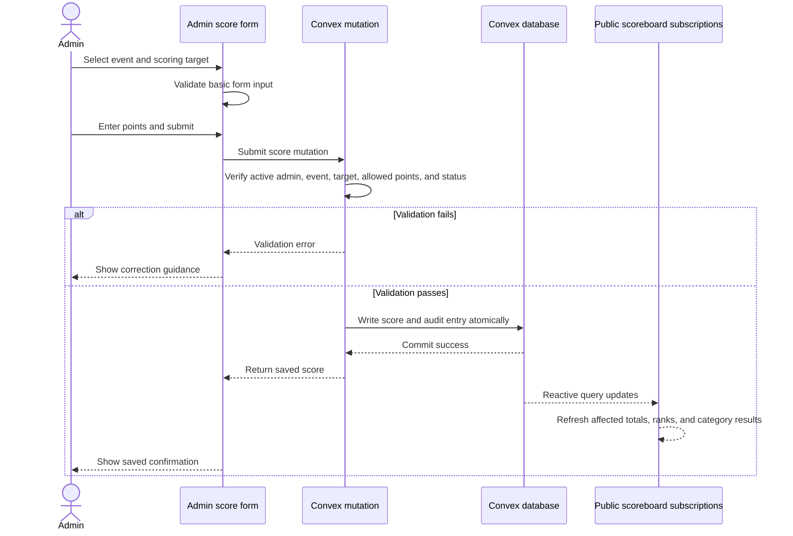
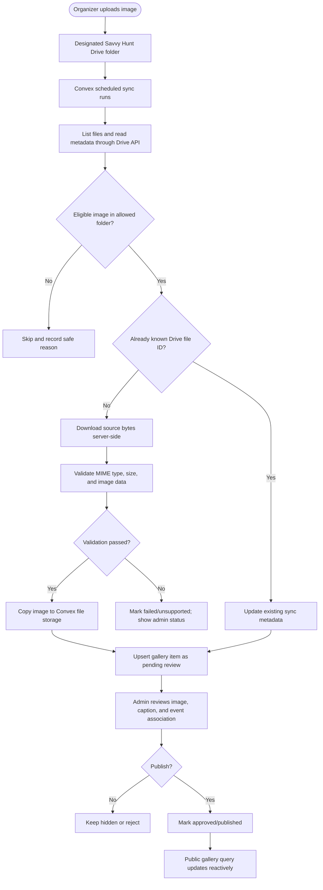
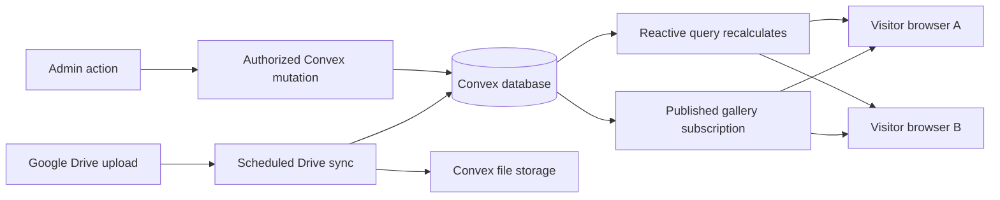
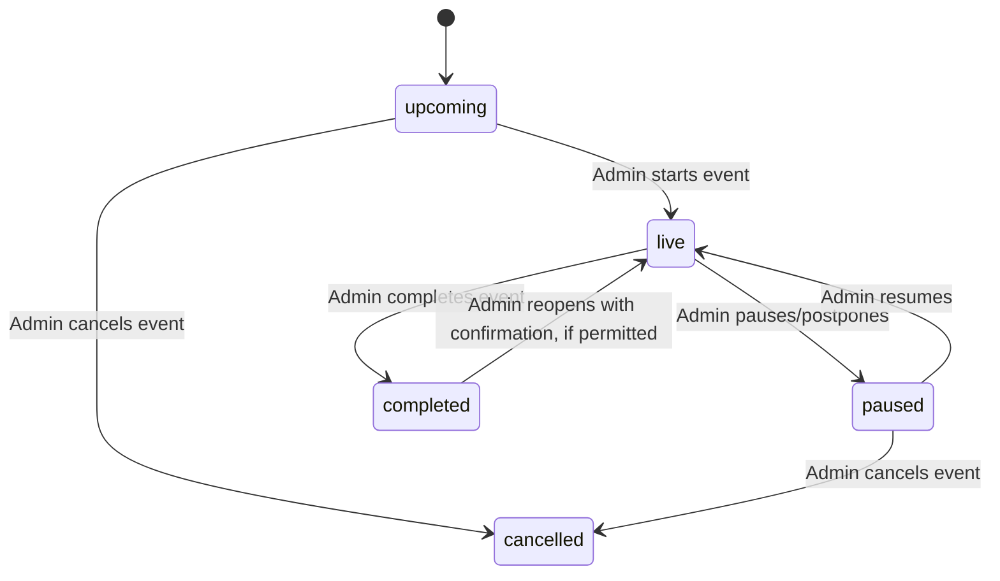
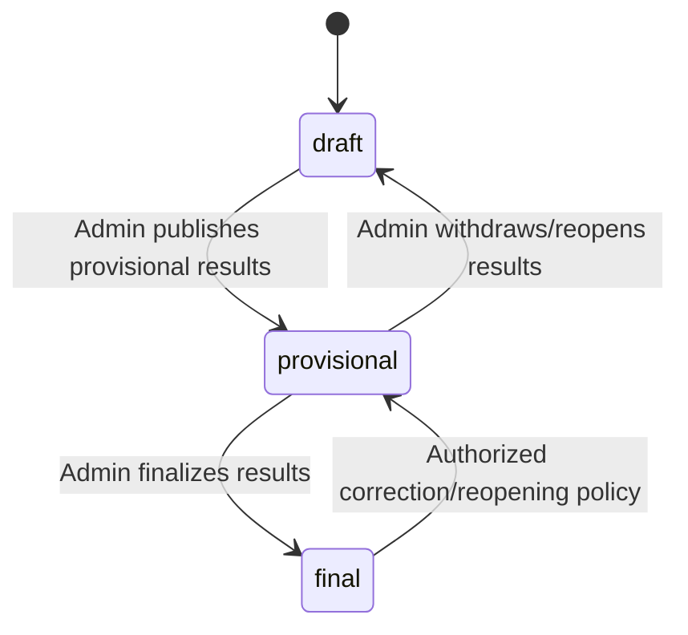

# Savvy Hunt — Application Flow

**Document:** `appflow.md`  
**Version:** 1.0  
**Date:** 28 October 2026  
**Status:** Proposed application flows; confirm open rules before implementation.  
**Related documents:** `plan.md`, `architectur.md`

---

## 1. Purpose

This document describes how people move through the Savvy Hunt website and how the application responds to their actions. It covers public visitor journeys, admin workflows, score publication, live updates, and Google Drive gallery synchronization.

The application is intended to use:

- **Next.js + React + TypeScript** for the website and admin dashboard.
- **Vercel** for hosting and deployment.
- **Convex** for application data, backend functions, and reactive real-time updates.
- **A supported authentication provider** for admin sign-in.
- **Google Drive** as the source folder for event photos.
- **Convex file storage** as the proposed delivery location for approved public images.

This document explains the intended behavior, not a claim that the application has already been implemented.

## 2. User Types

### 2.1 Public visitor

A visitor does not need an account. They can view published event information, school and category results, event statuses, the top-three leaderboard, and approved gallery photos.

### 2.2 Authorized admin

An admin must sign in and be authorized by the backend. An admin can create or edit events, enter and correct scores, publish results, and review/publish gallery items according to the configured permissions.

### 2.3 Background integration process

The Google Drive sync process runs on the backend. It is not a public user and must never rely on a browser-provided claim of authorization. It reads only the configured folder and updates gallery records safely.

---

## 3. Application Overview

## 4. First Visit and Navigation Flow

1. The visitor opens `/`.
2. The home page displays the current event overview, leading schools, upcoming/live events, recent published results, and recent approved snapshots when data exists.
3. The visitor chooses one of the main destinations:
   - **Scoreboard** for school-wise totals.
   - **Categories** for category-level standings.
   - **Schedule** for upcoming, live, and completed events.
   - **Who's Leading?** for the leading three schools.
   - **Snapshots** for approved photos and highlights.
4. Public pages query only data that is approved for public display.
5. If a section has no data, the site displays an intentional empty state instead of placeholder results or invented winners.

### Public navigation rules

- Public pages must not require admin login.
- Admin-only controls must not appear to public visitors, but backend authorization remains mandatory even if someone manually calls a backend function.
- The website should preserve the selected category when a visitor opens a category detail page and navigates back.
- All public pages should provide a consistent path back to the home page and main navigation.

---

## 5. Public Scoreboard Flow

### 5.1 School-wise scoreboard

Expected behavior:

1. The page subscribes to the backend query for published school totals.
2. Totals are calculated from eligible event score records according to the scoring rules agreed by organizers.
3. The page displays schools in descending total-point order.
4. When an eligible score changes, Convex pushes updated query results to connected clients.
5. The UI updates ranks and points without requiring a page refresh.
6. If the real-time connection is interrupted, the page indicates a connection issue when possible and recovers when the subscription reconnects.

### 5.2 Category-wise results

1. The visitor opens `/scoreboard/categories`.
2. The page lists available published categories.
3. The visitor selects a category.
4. The page requests published results for that category.
5. Results are grouped and ranked according to the configured event/scoring model.
6. New eligible results appear automatically through Convex subscriptions.
7. If there are no published results, show “Results have not been published yet” or an equivalent message.

The website must not combine school points and participant points into one leaderboard unless a clear aggregation rule has been confirmed.

### 5.3 “Who's Leading?” top three

1. The page/component requests the overall published school totals.
2. The backend applies the official ranking and tie rules.
3. The UI displays up to three schools.
4. If fewer than three schools have eligible results, show only the schools available.
5. If totals change, the top-three list updates reactively.
6. Equal totals must follow the approved tie rule; until that rule is confirmed, the recommended default is shared rank for equal totals.

### 5.4 Provisional and final result visibility

Recommended default:

- Draft/unpublished scores are visible to authorized admins only.
- Published provisional scores can be public only if organizers enable this behavior.
- Final results are public after an authorized admin publishes/finalizes them.
- Corrections to previously published scores must be audited and reflected consistently across all affected public views.

The exact distinction between saving, publishing, and finalizing must be agreed before coding.

---

## 6. Public Event Schedule Flow

The schedule contains three main views or filters: **Upcoming**, **Live**, and **Results & Winners**.

### Event card fields

Display only available, approved fields such as:

- Event name and category.
- Schedule date and time.
- Venue or location, if supplied.
- Current status.
- Result/winner summary if published.

### Event status behavior

- Status is maintained by admin actions and schedule metadata.
- Do not rely only on browser time to decide the official event state.
- If an event is postponed, paused, or manually marked live, reflect the authorized state.
- An event marked completed does not automatically mean its results are published.

---

## 7. Admin Sign-in and Access Flow

### Rules

1. There is no public admin registration page.
2. The initial admin is provisioned through a controlled process.
3. A valid identity-provider account alone does not grant admin rights.
4. Every protected query and mutation verifies authorization on the backend.
5. Disabled or removed admins must lose access to protected actions.
6. The interface must not expose secrets or private integration state.
7. After sign-out, protected views and mutations must no longer work with the old session.

### Sign-in failure cases

- Invalid credentials: show a generic, safe error.
- Authentication provider unavailable: show a temporary sign-in problem and allow retry.
- Authenticated but not authorized: show access denied; do not create an admin record automatically.
- Expired session: request re-authentication and do not silently accept protected writes.

---

## 8. Admin Dashboard Flow

After successful authorization, the admin lands on `/admin`.

The dashboard should summarize:

- Upcoming events.
- Live events.
- Events awaiting publication of results.
- Recent score changes.
- Google Drive synchronization state and last successful sync.
- Shortcuts to create an event, manage scores, review results, and manage photos.

The dashboard is a navigation and status view. Each management area performs its own backend permission checks and input validation.

---

## 9. Event Creation and Editing Flow

### Event fields

Required fields and optional fields should be agreed before coding. Proposed fields include:

- Event name — required.
- Category — required.
- Schedule date/time — as applicable.
- End time — optional if the schedule does not provide it.
- Venue — optional if not provided.
- Description — optional.
- Operational status — upcoming, live, postponed/paused, or completed as supported.
- Result publication state — draft/unpublished, published, or finalized if these states are adopted.

### Editing safeguards

- Validate the category and all referenced IDs on the backend.
- Prevent accidental duplicate form submissions.
- Warn admins before changing important status fields on events with published results.
- Do not silently delete an event that has scores or an audit history. Prefer an archive or cancellation workflow.
- Record who created/updated an event and when.

---

## 10. Score Entry and Correction Flow

### Score-entry sequence

1. Admin opens `/admin/scores`.
2. Admin selects the event/category.
3. The system lists valid score targets: school, participant, or both depending on the confirmed model.
4. Admin enters the points and optional correction note.
5. Frontend performs basic format validation for convenience.
6. Backend independently validates the request, authorization, event status, target IDs, and allowed point range.
7. Backend writes the score and audit record in the same mutation.
8. The UI shows success only after the backend confirms the commit.
9. Public reactive queries update all affected standings.

### Score correction safeguards

- Keep previous and new values in the audit record where appropriate.
- Record the admin identity and server timestamp.
- Require a reason for corrections if the organizers choose that policy.
- Prevent stale forms from silently overwriting a newer edit; use a revision/version check if needed.
- If a mutation fails, preserve the entered values and clearly show that the score was not saved.
- Do not let client-supplied totals override calculated school totals.

### Score state rules

The final states must be confirmed. A reasonable starting model is:

- **Draft:** admin-only; not used in public rankings.
- **Published/provisional:** visible publicly only if provisional publication is enabled.
- **Final:** included in official public results after an admin finalizes/publishes the result.

If the project chooses immediate-public scores instead, keep audit and authorization controls, but remove unnecessary states from the UI rather than implementing both models accidentally.

---

## 11. Result Review and Publication Flow

1. Admin opens the result review area.
2. The system lists events that have scores but are not final/published.
3. Admin opens an event/category and reviews the score entries, rankings, and any warnings.
4. The backend computes totals and standings from eligible score records.
5. Admin checks the displayed results against the official result sheet.
6. Admin chooses to publish/finalize if authorized.
7. Backend validates the action and writes a publication/finalization audit entry.
8. Public schedule, event detail, category results, and school leaderboard update reactively.
9. If a final score later needs correction, the correction must be audited and follow the approved re-opening/republication policy.

### Publication safeguards

- Do not infer winners from a draft or missing score.
- Do not label results final unless an authorized admin finalized them.
- Make tie behavior consistent across category results and school totals.
- Ensure published category results and overall totals are derived from the same approved source records.

---

## 12. Google Drive Photo Flow

### 12.1 Recommended default: sync, review, publish

### 12.2 Upload-to-public behavior

1. Organizer uploads an image into the designated Drive folder.
2. A scheduled backend sync checks the folder at the configured interval.
3. The integration fetches metadata and checks the file identity, location, MIME type, and size.
4. The same Drive file ID must not create duplicate gallery items.
5. Eligible files are downloaded securely by the backend and copied to Convex file storage.
6. The metadata record is created or updated with a `pendingReview` state by default.
7. Admin reviews the image, caption/alt text, and optional event/category association.
8. When approved, the item is marked published.
9. The public gallery's reactive query updates and visitors see the newly published image.

### 12.3 Why approval is the default

Savvy Hunt may include school students. Review allows organizers to check consent, accidental uploads, file quality, duplicate photos, and incorrect captions before public display. Automatic publication may be enabled later only as an explicit policy decision.

### 12.4 Sync delay and status

- Convex subscriptions update the gallery immediately after the gallery record is published.
- They do not detect a Drive upload by themselves.
- Time from Drive upload to appearance in the admin review queue depends on the Drive sync interval and sync duration.
- The admin dashboard should show the last successful sync and any current error state.
- A retry or “Sync now” control can be offered to authorized admins, with rate limiting and backend authorization.

### 12.5 File removal or access loss

If a source image is deleted, trashed, moved outside the configured folder, or becomes inaccessible:

1. The next reconciliation identifies the change.
2. The gallery record is marked unavailable or unpublished according to the agreed policy.
3. The public query stops returning it when it is no longer approved/available.
4. The sync history keeps a safe record of the change.
5. The copied image bytes may need to be deleted separately from Convex storage, remembering that a previously shared public URL may remain usable until the asset is actually removed.

### 12.6 Google Drive integration failures

- **OAuth expired/revoked:** record an admin-readable connection error; do not expose token data.
- **Drive API unavailable:** retry transient errors with limits and keep the last known safe gallery state.
- **Unsupported file type or oversized image:** skip the file and show a safe reason to admins.
- **Duplicate sync:** upsert by Drive file ID; never create a second entry for the same source file.
- **Partial run:** checkpoint progress and allow a later run to resume or reconcile.
- **Invalid image bytes:** reject the item and do not publish it.

---

## 13. Real-Time Update Flow

The application has two different update mechanisms:

1. **Convex-to-browser reactivity:** used for event status, scores, leaderboards, published results, and published gallery metadata. This should update connected clients without manual refresh.
2. **Google Drive-to-Convex synchronization:** used to detect new/changed Drive files. This is scheduled/reconciled in version 1, so it may have a delay.

### Real-time UI behavior

- Show an unobtrusive live/connection indicator where useful.
- Avoid excessive flashing or animation when totals change.
- Keep the visitor's selected category intact during updates.
- Use stable identifiers for list keys so rows do not flicker unnecessarily.
- If the browser is offline, do not claim that data is current; show a connection warning where possible.
- When the connection returns, ensure subscriptions render current server data.

---

## 14. Error and Recovery Flows

| Situation | Expected behavior | Must not happen |
|---|---|---|
| Public query has no data | Show a helpful empty state | Invent scores, winners, or schools |
| Admin is not authorized | Reject protected request and show access denied | Allow the operation because the UI route was reachable |
| Score fails validation | Show field-specific feedback | Display “saved” or update an authoritative total |
| Score mutation fails | Keep entered values and offer retry | Lose the form data without explanation |
| Duplicate score submission | Guard against accidental duplicate writes | Create unintended duplicate score components |
| Two admins edit the same record | Detect stale revision or otherwise apply an explicit conflict policy | Silently overwrite newer data |
| Realtime connection drops | Indicate connection issue and recover | Pretend the client is guaranteed current |
| Drive sync fails | Log safe error details and show sync status to admins | Leak OAuth tokens or delete the known-good gallery without policy |
| Image does not pass validation | Reject and explain to admins | Publish invalid or unsupported files |
| Image is unpublished | Remove it from public gallery queries | Continue exposing it through normal gallery navigation |
| Event result is not published | Show event information and a pending-results message | Display unverified winners as final |

Errors should be actionable but must not reveal secrets, private tokens, internal stack traces, or unnecessary personal data.

---

## 15. Event and Score State Transitions

### 15.1 Event operational status

Proposed status values:

- `upcoming`
- `live`
- `paused` or `postponed` (choose exact naming)
- `completed`
- `cancelled` (if the organizers need it)

Suggested transitions:

Only authorized admins may change operational status. Reopening a completed event should require confirmation and an audit entry if that operation is allowed.

### 15.2 Result publication state

Suggested states if the organizers need a distinct publication workflow:

Do not implement event operational status and result publication status as a single field. An event can be completed while its results are still unpublished.

If organizers decide that scores should become public immediately, simplify this model rather than creating unnecessary approval steps.

---

## 16. Audit and Accountability Flow

Audit entries should be created for meaningful changes such as:

- Event created, edited, archived, or status changed.
- Score created or corrected.
- Result published, finalized, withdrawn, or reopened.
- Gallery item approved, hidden, or removed.
- Admin authorization changed.
- Drive sync started/completed/failed, summarized without secrets.

For score changes, keep the target, event, prior/new values as appropriate, actor, server timestamp, and correction reason when provided. Audit history should be append-only through normal app flows; ordinary admins should not be able to rewrite history.

---

## 17. Primary Routes and User Journeys

### Public

| Route | Main flow | Data visibility |
|---|---|---|
| `/` | Overview → navigate to core sections | Published public data only |
| `/scoreboard` | View school totals → observe live updates | Published/eligible scores only |
| `/scoreboard/categories` | Choose category | Published category data only |
| `/scoreboard/categories/[categorySlug]` | View category standings | Published/eligible scores only |
| `/schedule` | Filter upcoming/live/completed | Published event metadata |
| `/events/[eventId]` | View event status and published results | No draft results |
| `/gallery` | Browse published snapshots | Approved and available images only |

### Admin

| Route | Main flow | Permission expectation |
|---|---|---|
| `/admin/login` | Sign in | Authentication provider handles identity |
| `/admin` | View operational overview | Active authorized admin |
| `/admin/events` | List/manage events | Active authorized admin |
| `/admin/events/new` | Create event | Active authorized admin |
| `/admin/events/[eventId]` | Edit event/status | Active authorized admin |
| `/admin/scores` | Enter/correct scores | Active authorized admin |
| `/admin/results` | Review/publish results | Active authorized admin |
| `/admin/gallery` | Review/publish/hide images | Active authorized admin |
| `/admin/settings` | Configure approved settings and integration status | Restricted authorized admin |

Route names are proposed and may be adjusted during implementation. Backend authorization is required regardless of route.

---

## 18. Acceptance Scenarios

Use these scenarios as functional acceptance tests.

### Scenario A — Visitor views school standings

**Given** published scores exist for multiple schools,  
**when** a visitor opens `/scoreboard`,  
**then** schools appear in descending order under the agreed tie rule, with correct total points.

### Scenario B — Score changes live

**Given** a visitor is watching a scoreboard and an authorized admin is signed in elsewhere,  
**when** the admin saves a valid score,  
**then** Convex commits the score and audit entry and the visitor's connected scoreboard updates without a manual page refresh.

### Scenario C — Unauthorized person attempts to edit a score

**Given** a user is not an active authorized admin,  
**when** they attempt to invoke a protected score mutation,  
**then** the backend rejects the request and no score or audit mutation is applied as if successful.

### Scenario D — Results are not yet published

**Given** an event has saved scores but results remain unpublished,  
**when** a public visitor opens the event page,  
**then** the page shows the event status and a pending-results message, not draft scores or fabricated winners.

### Scenario E — New photo arrives in Drive

**Given** an eligible image is uploaded to the configured Drive folder,  
**when** the next sync discovers and imports it,  
**then** the metadata is stored once, the image is copied to the agreed public delivery storage, and the gallery item waits for review by default.

### Scenario F — Admin publishes a photo

**Given** a gallery item is pending review,  
**when** an authorized admin publishes it,  
**then** the public gallery subscription updates and the image appears without a page refresh.

### Scenario G — Drive sync fails

**Given** the Google Drive API is temporarily unavailable,  
**when** a scheduled sync runs,  
**then** the system records a safe failure status, retains the last known safe public gallery state, and retries according to the configured policy.

### Scenario H — A final score must be corrected

**Given** a result has already been published or finalized,  
**when** an authorized admin requests a correction,  
**then** the app follows the approved reopening/correction policy, records an audit entry, and updates affected public views only after the change succeeds.

---

## 19. Assumptions and Open Decisions

### Assumptions used in these flows

- Public access does not require login.
- Admin access is restricted to explicitly authorized accounts.
- Convex is the source of truth for event and score data.
- Scoreboards derive totals from event-level score records.
- New Drive images are synchronized automatically but reviewed before public display.
- Approved images are copied to Convex file storage for public delivery.
- Convex reactive queries update connected clients when relevant records change.

### Decisions to confirm

1. Do score entries belong to schools, individual participants, or both?
2. If participants earn points, do those points contribute to the school's overall total?
3. Should scores appear publicly immediately after being saved, or only after publication?
4. Are provisional and final results both needed?
5. Should tied schools share a rank, use a tie-breaker, or allow an admin to decide?
6. Should admins be able to correct finalized scores, and should a correction reason be mandatory?
7. Who provisions the initial admin account? Is one admin role sufficient for launch?
8. Must all new gallery images be approved, or should some folders publish automatically?
9. Is a sync delay of a few minutes acceptable, or are near-instant Drive updates required?
10. Can approved images be served publicly from Convex file storage, and what photo-consent/removal policy does the school require?
11. What exact event statuses are needed: upcoming, live, paused/postponed, completed, cancelled?
12. Should event results and gallery photos remain available after the program ends?

---

## 20. Implementation Guidance

Implement and test the application flows in this order:

1. Confirm scoring targets, aggregation, tie rules, and publication policy.
2. Create the Convex schema and secure admin authorization.
3. Implement event create/edit/status flows.
4. Implement score entry, validation, and audit logging.
5. Implement school totals, category standings, and top-three query logic.
6. Build public schedule, scoreboard, category, event-detail, and home pages.
7. Verify live updates with at least two browser sessions.
8. Implement Drive sync into a test folder, image validation, storage copy, review, and publication.
9. Test failure/recovery, permissions, privacy, and mobile layouts.
10. Rehearse the complete event workflow with organizers before production launch.

**Recommended go-live gate:** do not launch until the organizers have tested entering a score, correcting it, confirming the resulting leaderboard, publishing results, and publishing/removing a gallery image.
