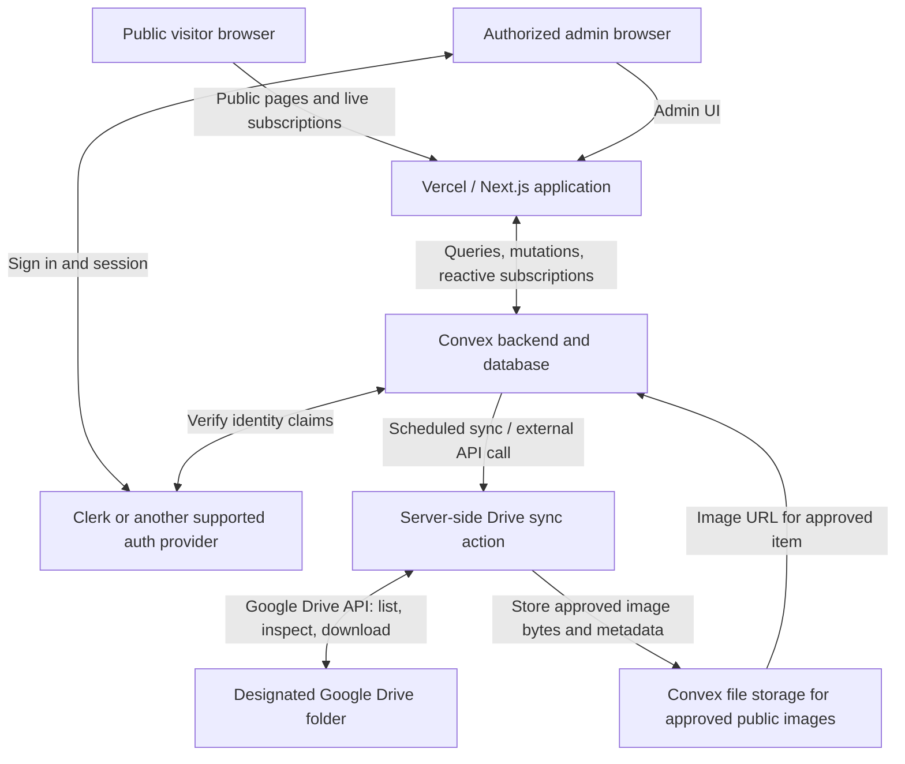
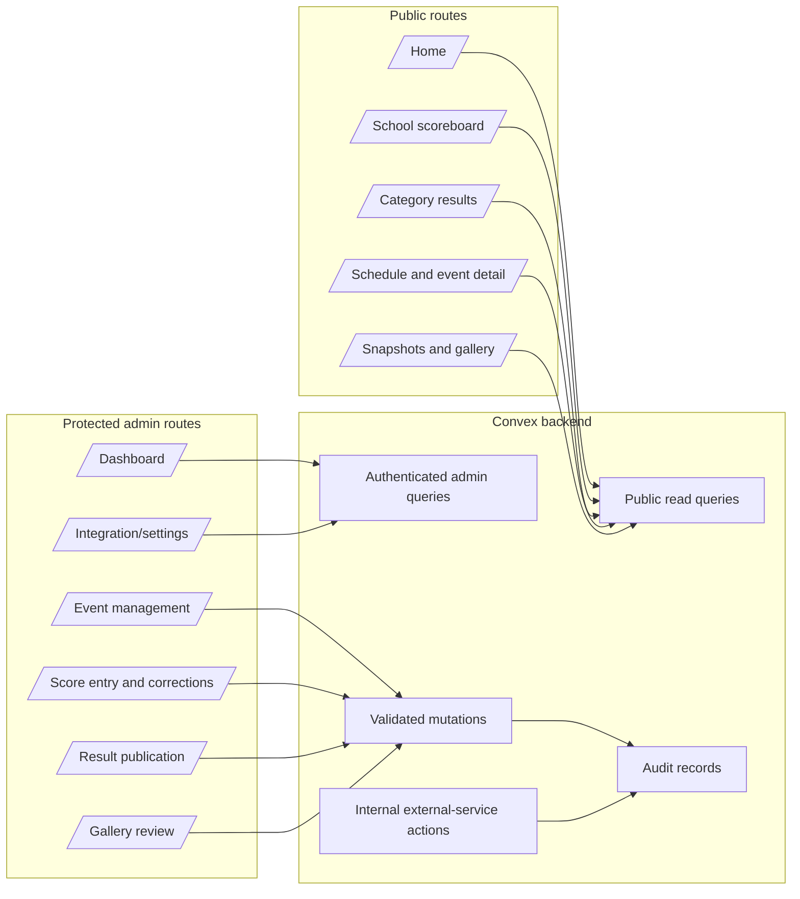
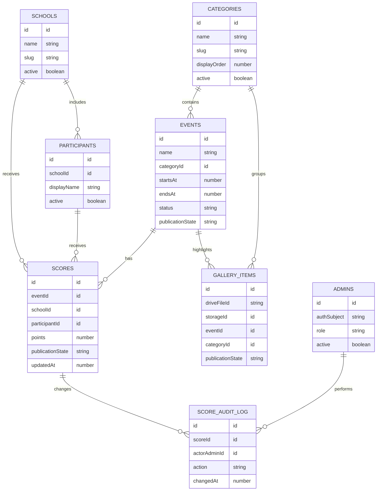
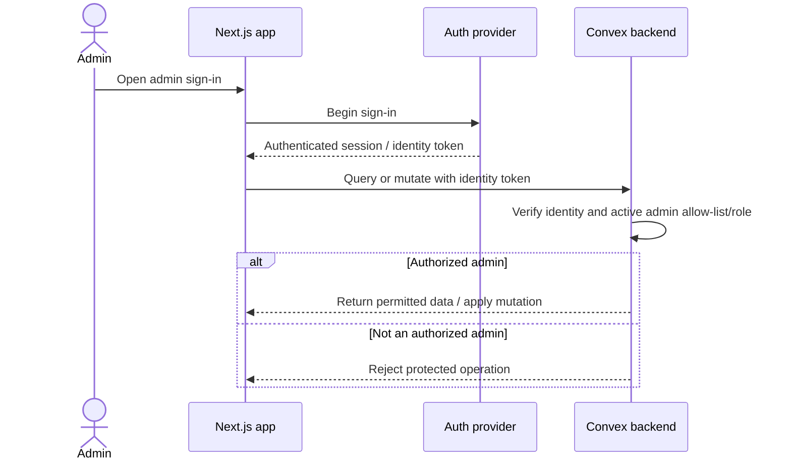
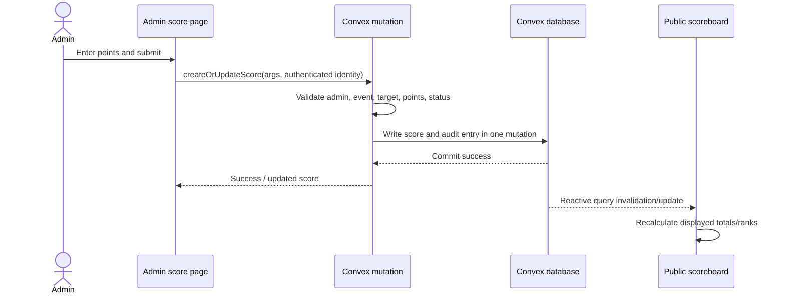
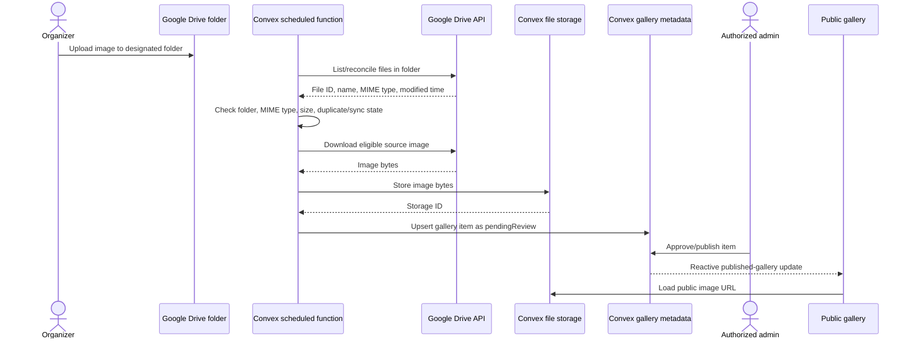
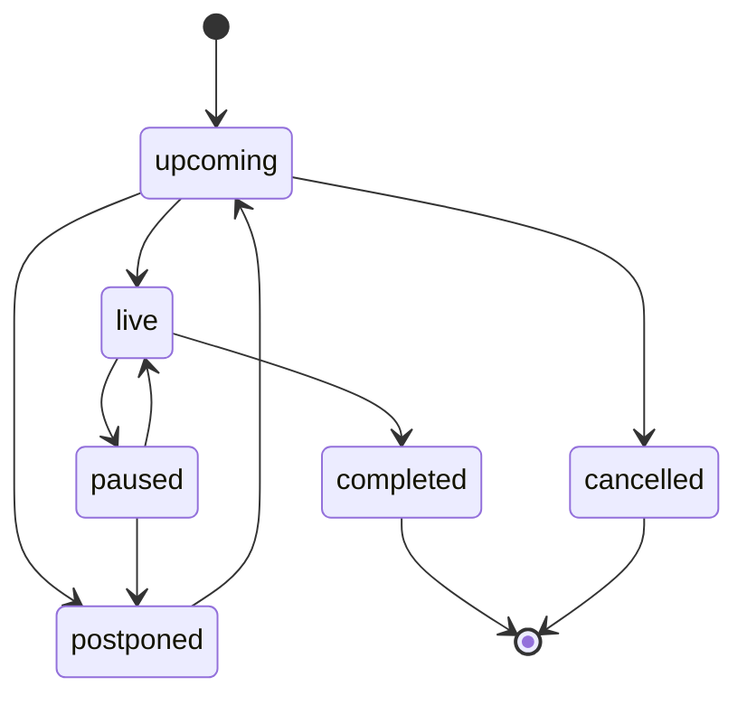

# Savvy Hunt — System Architecture

**Document:** `architectur.md`  
**Version:** 1.0  
**Date:** 28 October 2026  
**Status:** Proposed architecture; confirm the open decisions before implementation.  
**Related document:** `plan.md`

---

## 1. Purpose

This document defines the proposed technical architecture for the Savvy Hunt school-event website. It describes the application layers, service responsibilities, data relationships, authorization model, live-score flow, Google Drive gallery integration, deployment environments, and reliability requirements.

The architecture is designed around these confirmed requirements:

- Multiple schools compete across categories and events.
- Admins enter scores manually.
- Public visitors can view school-wise and category-wise results.
- Scoreboard and event updates should appear without manual page refresh.
- The public site includes upcoming/live events, results and winners, a top-three “Who's Leading?” section, and a photo/highlight gallery.
- Only authorized admins can access management features.
- Vercel is the preferred website host, Convex is the preferred data/realtime backend, and Google Drive is the source for gallery uploads.

### Core design decisions

1. **Convex is the source of truth** for schools, categories, events, scores, publication state, audit history, and gallery metadata.
2. **Convex reactive queries** deliver live updates to connected browser clients.
3. **Google Drive is an ingest/source system**, not the public image delivery mechanism and not the source of score data.
4. **Only approved gallery items are publicly queryable** by default.
5. **All write operations are authorized and validated in backend functions.** Hiding controls in the frontend is not security.
6. **School totals and rankings are derived from event-level scores**, not manually maintained duplicate totals, unless a separate audited override feature is explicitly approved.
7. The design supports an initial single `admin` role, with an option to expand to more granular roles later.

---

## 2. High-Level Architecture



### 2.1 Logical layers

| Layer | Technology | Responsibility |
|---|---|---|
| Presentation | Next.js, React, TypeScript, Tailwind CSS | Public pages, admin dashboard, forms, responsive views |
| Identity | Clerk or another Convex-supported provider with Next.js support | Admin sign-in, sessions, account lifecycle, identity tokens |
| Application backend | Convex queries, mutations, actions, scheduled functions | Business rules, validation, authorization, data reads/writes, integration workflows |
| Primary data | Convex database | Schools, categories, events, scores, audit log, gallery metadata and sync state |
| Image delivery | Convex file storage for the initial modest public gallery | Serve selected/approved image assets without exposing private Drive credentials |
| Photo source | Google Drive API | Organizer uploads, original files, source metadata |
| Hosting/deployment | Vercel + GitHub | Next.js hosting, preview deployments, production deployment |

### 2.2 What is not required for version 1

- A separate REST API server solely for normal application data.
- A separate WebSocket service for score updates; Convex subscriptions cover this.
- A separate cache/database for derived school totals unless measurement shows it is needed.
- A public account registration flow.
- Public upload endpoints for gallery photos.
- A Vercel Cron job solely to poll Google Drive; Convex scheduled functions can run the sync workflow. Drive push notifications can be a later enhancement.

---

## 3. Technology Choices

### 3.1 Frontend and hosting

- **Next.js App Router** for route management and public page rendering.
- **React + TypeScript** for UI components and typed data.
- **Tailwind CSS** for styling.
- **Accessible component primitives** (for example, shadcn/ui where appropriate) for forms, tables, dialogs, and navigation.
- **Vercel** for preview and production deployment.

Use Server Components for mostly static page structure and SEO-oriented content where useful. Use Client Components with Convex React hooks for the parts that must stay live, including scoreboards, event status, and the leaderboard. A page can render its layout server-side while subscribing to live data in a client component.

### 3.2 Convex backend

Use Convex for:

- Typed schema and indexed data access.
- Public read queries limited to published data.
- Authenticated admin queries.
- Validated mutations for event and score changes.
- Internal actions for Google Drive API calls and image ingestion.
- Scheduled functions for periodic Drive folder reconciliation.
- Reactive subscriptions for scoreboards and event updates.

Keep business rules in backend functions rather than duplicating them in page components.

### 3.3 Authentication choice

Use **Clerk + the official Convex integration** as the default option for a Next.js deployment, or another auth provider only after checking its current Next.js and Convex integration support. Do not make a custom password/session system unless there is a concrete requirement.

Convex Auth should not be selected automatically for this project without rechecking its status and Next.js support during implementation; its documentation currently describes it as beta and notes that some Next.js server-side support is under active development.

Authentication and authorization are different:

- **Authentication:** identifies who has signed in.
- **Authorization:** confirms that the signed-in identity is an approved Savvy Hunt admin.

A valid Clerk session alone must not grant administrative access unless the backend also confirms the user is allow-listed or has an active admin record/role.

### 3.4 Google Drive and image delivery

For the first version:

1. Organizers upload originals to one designated Drive folder.
2. A scheduled Convex action lists or reconciles eligible files through the Drive API.
3. The action checks MIME type, size, folder membership, and sync state.
4. The server downloads eligible image bytes using server-side credentials.
5. The approved image is copied to Convex file storage and its storage ID is recorded in Convex database metadata.
6. An admin approves or hides the gallery record.
7. Public gallery queries return only approved, available items and their display URLs.

This avoids depending on a private Drive URL that public visitors may not be authorized to fetch. It also keeps Google OAuth tokens off the client. Because Convex-generated file URLs are bearer URLs, only create and publish them for files explicitly approved for public viewing. If the project later needs revocable/expiring delivery links or a larger image library, evaluate a dedicated object store such as Cloudflare R2 instead.

---

## 4. Application Boundaries



### Boundary rules

- Public routes must not call a privileged API key or reveal private fields.
- Public Convex queries should return purpose-built DTOs, not whole internal database records.
- Admin pages must authenticate before showing protected data, but backend functions must independently recheck authorization.
- Google Drive credentials are used only in server-side actions.
- Public image URLs are returned only when the associated gallery item is published.
- Unpublished scores and draft event data must not leak through public queries or derived leaderboard queries.

---

## 5. Route Architecture

### Public routes

| Route | Responsibility |
|---|---|
| `/` | Event overview, top three, upcoming/live events, recently published snapshots |
| `/scoreboard` | Overall school-wise rankings and totals |
| `/scoreboard/categories` | Category selector and category summary |
| `/scoreboard/categories/[slug]` | Results for one category |
| `/schedule` | Upcoming, live, and completed/result-published events |
| `/events/[eventId]` | Event details and published results/winners |
| `/gallery` | Approved event photos and highlights |

### Admin routes

| Route | Responsibility |
|---|---|
| `/admin/login` | Admin sign-in entry point |
| `/admin` | Dashboard and latest activity |
| `/admin/events` | List and manage events |
| `/admin/events/new` | Create an event |
| `/admin/events/[eventId]` | Edit event metadata, status, and publication state |
| `/admin/scores` | Enter and correct event scores |
| `/admin/results` | Review, finalize, and publish results if this workflow is enabled |
| `/admin/gallery` | Review synced Drive images, set captions/associations, publish or hide items |
| `/admin/settings` | Restricted settings and Drive sync health |

Route naming can change, but public and admin functionality should remain logically separated.

---

## 6. Domain Model

The schema below is conceptual. Exact Convex validators, indexes, optional fields, and delete behavior must be implemented in `convex/schema.ts` after scoring rules are confirmed.



### 6.1 Proposed tables

#### `schools`
- `name`: canonical school name.
- `slug`: stable route/display identifier, unique by application validation.
- `logoStorageId` or approved logo reference: optional.
- `active`: whether the school is included in active event configuration.
- `createdAt`, `updatedAt`.

#### `categories`
- `name`, `slug`, optional `description`.
- `displayOrder` for consistent UI ordering.
- `active`.
- `createdAt`, `updatedAt`.

#### `events`
- `name`, `categoryId`, optional description and venue.
- `startsAt`, optional `endsAt` as UTC timestamps; display in the event's configured local timezone.
- `status`: proposed values `upcoming`, `live`, `paused`, `postponed`, `completed`, `cancelled`.
- `publicationState`: proposed values `draft`, `published`, `archived`.
- Optional `resultsState`: `notReady`, `provisional`, `final` if the organizers approve this distinction.
- Creator/updater identity and timestamps.

Keep `status` separate from `publicationState`: an event may be live but not public, or completed but still awaiting result publication.

#### `participants` (conditional)
Use this table only if some events score individual participants. Collect only display information necessary for the event. Avoid student phone numbers, home addresses, dates of birth, or other unnecessary personal data.

#### `scores`
- `eventId`.
- `schoolId` and/or `participantId`, based on the confirmed event's scoring target.
- `points`.
- Optional note and correction reason.
- `publicationState` or an explicit result visibility/status field.
- `createdBy`, `updatedBy`, `createdAt`, `updatedAt`.
- Optional revision/version value to detect stale admin forms if needed.

The implementation must enforce a valid target combination. If a score is school-level, it should reference a school and have no participant ID. If participant-level, it should reference a participant and have a documented rule for whether those points contribute to the school's total.

Do not create duplicate rows for the same event/target unless an event intentionally supports multiple score components. If multiple components are required, add a `scoreComponent` or `criterionId` to the uniqueness rule.

#### `scoreAuditLog`
- Related score/event ID.
- Actor identity.
- Action type, old value, new value, reason, timestamp.
- Optional correlation/request ID.

Create audit records in the same mutation as the score update whenever possible. Ordinary admin UI operations should append audit records, not edit history.

#### `galleryItems`
- `driveFileId`: stable source key; do not key by file name.
- `sourceFolderId`, source name, MIME type, source modified time.
- `storageId`: Convex file storage ID for the copied image, if ingestion succeeded.
- Optional event/category associations.
- `caption`, `altText`, `displayOrder`.
- `publicationState`: proposed values `pendingReview`, `published`, `hidden`, `unavailable`.
- Sync state, last synced timestamp, and safe error summary.
- `reviewedBy`, `reviewedAt`, `publishedBy`, `publishedAt`, when applicable.

#### `admins` (or equivalent allow-list)
- Authentication-provider subject/user ID.
- `role` (initially `admin`), `active`.
- Created/updated timestamps.

The external auth provider should own passwords and credentials. Do not store password hashes in the application's `admins` table if Clerk or another managed provider is used.

#### `driveSyncRuns` (recommended)
- Start/end timestamps, status, files examined/imported/updated/skipped.
- Safe error summary, retry count, cursor/checkpoint where used.
- Actor/source (`scheduled`, `manual admin retry`, `webhook`).

### 6.2 Indexes and query access patterns

Create indexes based on actual query patterns. At minimum, plan for:

- Schools by slug and active state.
- Categories by slug and display order.
- Events by category, status, publication state, and start time.
- Scores by event, by school, and by participant where applicable.
- Gallery items by publication state and sort order; by Drive file ID for idempotent upserts.
- Admin records by authentication subject.
- Audit log by score/entity and timestamp.

Exact Convex index names and compound-index order depend on the final query implementations. Avoid collecting every record in a table and filtering in application code once the dataset could grow.

---

## 7. Score Calculation and Publication Model

### 7.1 Calculation rules

- A score is entered against an event and its valid scoring target.
- A category result includes eligible scores from events in that category.
- A school total sums eligible published scores for that school under the agreed aggregation rule.
- “Who's Leading?” is derived from overall school totals and returns up to three schools.
- The public scoreboard uses only records permitted by the publication policy.
- Ranking and tie rules must be implemented in one backend/domain function, not separately in multiple components.

### 7.2 Recommended default

Until organizers say otherwise:

- Draft/unpublished scores are private to admins.
- Published scores appear immediately in public reactive queries.
- School totals are computed from event-level records.
- Equal totals share a rank; use a deterministic display ordering (for example, school name) without presenting that order as a tie-break result.
- A score correction is allowed only to an authorized admin, is audited, and updates live views after the mutation succeeds.

### 7.3 Derived totals: compute versus cache

Start by computing totals from indexed score records inside backend queries. This minimizes consistency risks for a school-scale event. If profiling later shows that calculation is too expensive, introduce cached summary documents updated atomically in relevant mutations and add tests that compare summaries with a full recomputation.

Never maintain the leaderboard as a manually editable list separate from canonical score records.

---

## 8. Authentication and Authorization

### 8.1 Sign-in flow



### 8.2 Mandatory rules

- No public admin registration.
- Provision the first admin through a documented controlled process.
- Every admin query and mutation must check identity and current admin status.
- An inactive or removed admin must lose access even if they still have a valid identity-provider account.
- Do not use client-side route guards as the only authorization mechanism.
- Public queries must not return admin identities, audit details, unpublished scores, private integration state, Drive IDs/metadata that do not need to be public, or secret fields.
- Limit admin capabilities to roles if multiple roles are introduced.
- Log sensitive actions (score corrections, finalization, publication state changes, admin access changes).

### 8.3 Service authentication for the Drive sync

- The scheduled sync runs as a trusted backend process, not as a public admin mutation.
- Keep Drive OAuth client secrets and refresh tokens in Convex server-side environment variables or the platform's supported secret configuration.
- If a public endpoint is needed for a Drive notification webhook in a later phase, verify the notification channel/token and then fetch/reconcile the actual Drive changes. Do not treat an unauthenticated webhook body as authoritative file metadata.
- Never put Convex deployment/admin keys or Google refresh tokens in `NEXT_PUBLIC_*` variables.

---

## 9. Public and Admin Data APIs

In Convex, these are functions rather than conventional REST endpoints. The names below are logical contracts; exact function filenames can change.

### Public queries

| Query | Input | Output |
|---|---|---|
| `public.getHomeSummary` | none | Published event status summary, top three, latest gallery items |
| `public.listSchoolLeaderboard` | optional event scope if approved | Ranked schools with eligible totals |
| `public.listCategories` | none | Active published categories |
| `public.getCategoryResults` | category ID/slug | Published category events and scores |
| `public.listEvents` | status/filter | Published event summaries sorted by start time |
| `public.getEventDetails` | event ID | Published event details and public results |
| `public.listGalleryItems` | optional category/event/page cursor | Published image items only |

Public query output should be intentionally shaped. Do not pass raw database documents through the public boundary without reviewing every field.

### Admin queries

| Query | Purpose |
|---|---|
| `admin.getDashboardSummary` | Upcoming/live events, unpublished results, latest admin activity, sync status |
| `admin.listEvents` | All events visible to the authorized admin |
| `admin.getEventForEditing` | Event details including editable fields and related score state |
| `admin.listScoresForEditing` | Scores including unpublished items and safe audit context |
| `admin.listGalleryReviewQueue` | Pending, hidden, unavailable and published items |
| `admin.getDriveSyncHealth` | Last run, counters, safe error details |

Each query must independently authorize the caller.

### Mutations

- `admin.createEvent`
- `admin.updateEvent`
- `admin.changeEventStatus`
- `admin.createOrUpdateScore`
- `admin.publishScoreOrResult` (depending on the chosen publication model)
- `admin.correctScore`
- `admin.publishGalleryItem`
- `admin.hideGalleryItem`
- `admin.updateGalleryMetadata`
- `admin.requestDriveSync` (schedules or starts an internal workflow after authorization)

Mutations should validate identifiers, target combinations, point ranges, status transitions, publication rules, and authorization. Use backend errors that are understandable but do not leak implementation secrets.

### Internal actions

- `driveSync.syncFolderPage`
- `driveSync.ingestImage`
- `driveSync.reconcileFolder`
- `driveSync.recordRunResult`

These names are illustrative. Mark internal-only functions as internal wherever possible; do not expose external-service actions publicly without a strict gate.

---

## 10. Real-Time Score Update Flow



### Reliability requirements

- Do not show “saved” until Convex confirms the mutation committed.
- Display a useful validation error when it fails.
- Disable or guard duplicate submissions while a mutation is pending.
- If using optimistic UI, make rollback behavior explicit and do not present an unconfirmed score as authoritative.
- Store timestamps server-side.
- Record the actor and the before/after values for corrections.
- Test two admin sessions editing the same score; prevent stale overwrites with a revision/version check if needed.
- Test browser disconnect/reconnect and confirm live queries return the latest data after reconnection.
- Use stable row keys and restrained update animation so a leaderboard does not become hard to read when ranks change.

---

## 11. Google Drive Gallery Ingestion

### 11.1 Recommended version-one workflow



### 11.2 Scheduled synchronization

Start with scheduled reconciliation rather than push notifications:

- Schedule a Convex function to check the designated Drive folder at an agreed interval.
- Keep a per-run record with status, counts, and safe error summaries.
- Use Drive file IDs as source identifiers and upsert records idempotently.
- Use pagination and continue from a stored checkpoint for larger folders.
- Reconcile the current folder periodically so missed changes do not persist indefinitely.
- Do not assume Convex database reactivity means Drive changes are detected instantly: upload-to-website latency depends on the sync interval and work duration.

A “Sync now” admin control may request the same server-side workflow, subject to authorization and rate limiting.

### 11.3 Drive permissions and credentials

- Use a dedicated Drive folder for Savvy Hunt images.
- Grant the integration only the access necessary to read that folder.
- Use the appropriate OAuth flow and approved account for the actual Google Drive ownership model. Confirm whether the school uses a personal account or Google Workspace before implementation.
- Keep OAuth secrets and refresh tokens in server-side secret storage.
- Do not fetch private Drive images directly from visitor browsers.
- Never return Drive access tokens or OAuth credentials to the client.
- Do not trust file names or extensions; verify MIME type and file metadata.
- Configure image file size and supported-type limits.

### 11.4 Publication and safeguarding

Default policy: automatically sync image metadata and bytes, then place the item in `pendingReview`. An authorized admin must publish it before the public query returns it.

This is important because Savvy Hunt may include photos of school students. The organizers should confirm photo permissions, consent, and a process for removing a photo if requested.

If the organizers choose automatic publication, make it an explicit configuration choice and document the associated risk.

### 11.5 Deleted, moved, or inaccessible files

If a source file is trashed, moved outside the designated folder, or becomes inaccessible:

1. Mark its gallery record `unavailable` or apply the approved removal policy.
2. Ensure the public gallery no longer returns it if it should no longer be displayed.
3. Do not silently delete audit/sync evidence of what changed.
4. If the copied image is removed from Convex storage, remember that already-shared public URLs may remain usable until the corresponding file is deleted; a bearer URL is not a permission-aware session.

### 11.6 When to consider Drive push notifications

Google Drive push notifications may reduce detection delay, but require a reachable HTTPS webhook, notification-channel lifecycle management, validation, and reconciliation for missed/expired notifications. Add this only if several-minute upload-to-gallery latency is not acceptable. The webhook should trigger a reconciliation/fetch; it should not treat the notification payload as the complete change record.

---

## 12. Event Lifecycle and State Handling

Use separate fields for operational status and publication state.

### Event operational status



These are proposed transitions, not an unchangeable rule. Define which transitions are allowed and who can perform them before implementation.

### Result publication state

Proposed lifecycle:

- `draft`: only authorized admins can view.
- `provisional`: public visibility only if the organizer explicitly wants provisional results shown.
- `published`: returned by public queries.
- `final`: optional marker that the organizer considers the result final; correction policy still applies.

Do not infer “final” just because an event's scheduled end time has passed. An authorized admin should control result finalization.

---

## 13. Error Handling and Observability

### Application errors

- Invalid score or unsupported target: return validation feedback; do not write partial data.
- Unauthorized mutation: reject it and record security-relevant metadata without logging tokens.
- Missing event/category/school: show a safe not-found or validation response.
- External Drive API failure: record a failed sync run, retry transient failures, and leave existing valid gallery entries usable unless policy requires removal.
- Storage failure after download: do not mark the item as successfully ingested.
- Partial sync failure: checkpoint and resume safely; retries must not create duplicates.

### Operational signals

Monitor:
- Vercel deployment/runtime errors.
- Convex function errors and usage.
- Time taken for score mutations and public queries.
- Last successful Google Drive sync.
- Number of files checked, imported, skipped, and failed.
- Admin authorization failures and unexpected state transitions.

Never log OAuth access tokens, refresh tokens, authentication cookies, or unnecessary student information. Error summaries shown to admins should be actionable but safe.

---

## 14. Performance and Scale

The expected first deployment is a school event, so prioritize correctness and clarity over premature complexity.

- Use indexed Convex queries for event, score, category, school, gallery and audit access patterns.
- Subscribe only to the data needed by each active page; do not subscribe every visitor to unrelated admin data.
- Keep public query payloads small and omit audit/internal metadata.
- Paginate gallery items rather than loading every image at once.
- Store image files in image storage, not as large blobs inside regular database documents.
- Use image thumbnails or responsive image variants when appropriate.
- For leaderboards, calculate from the canonical score dataset initially; profile before caching.
- Test with a realistic upper bound for schools, events, categories, and concurrent viewers before the event.
- Include a visible connection/data freshness state without exposing backend internals.

If traffic or data volume grows beyond the free/service limits, measure actual usage and upgrade or redesign the affected part rather than assuming a particular plan will always be sufficient.

---

## 15. Security and Data Integrity Checklist

- [ ] Only approved users can enter the admin area.
- [ ] Every admin query and mutation independently checks authorization.
- [ ] Public queries expose only published fields and records.
- [ ] No public self-registration or password storage is implemented unintentionally.
- [ ] Server secrets are not included in browser bundles or `NEXT_PUBLIC_*` variables.
- [ ] Google Drive integration is restricted to the dedicated folder.
- [ ] File types, sizes, and source location are validated.
- [ ] Duplicate Drive file processing is idempotent.
- [ ] Score and audit records are written consistently.
- [ ] Score corrections have actor/time and, if required, a reason.
- [ ] Stale/concurrent score updates are handled safely.
- [ ] Public gallery query returns only published and available images.
- [ ] Student photo consent and removal policy is documented.
- [ ] Production and development databases/Drive folders are separated.
- [ ] Errors and logs do not expose tokens or unnecessary personal data.
- [ ] Admin account revocation works without code changes or redeployment.
- [ ] Test coverage includes unauthorized requests and unpublished-data leakage.

---

## 16. Deployment and Configuration

### Environments

1. **Local development** — local Next.js app, Convex development deployment, test Drive folder, test admin accounts.
2. **Preview/staging** — Vercel preview deployment, staging Convex deployment, staging Drive folder, test data.
3. **Production** — Vercel production deployment, production Convex deployment, approved Drive folder, authorized admins only.

Do not let preview builds write production scores or sync the production photo folder by default.

### Environment variable categories

Names will be confirmed during setup. Do not place secrets in client-exposed variables.

| Variable category | Location | Notes |
|---|---|---|
| Convex deployment URL | Public only if required by the official client setup | Not a privileged admin credential |
| Auth provider public key/domain | Public where the provider requires it | Must be intended for browser exposure |
| Auth provider secret keys | Server/provider configuration | Never browser-exposed |
| Google OAuth client secret and refresh token | Convex server-side environment/secret settings | Never sent to browsers |
| Google Drive folder ID | Server-side integration configuration by default | Treat as integration configuration; public UI does not need it |
| Drive sync interval/settings | Server-side configuration | Do not accept untrusted public values |

### Release procedure

1. Check schema/function changes in a development deployment.
2. Run lint, type-check, unit tests, integration tests, and critical browser tests.
3. Test the score update in two browser sessions.
4. Test private/unpublished data access as an unauthenticated visitor.
5. Test Drive sync using the staging folder.
6. Verify image approval and removal behavior.
7. Seed verified schools, categories, events, and schedule.
8. Provision admins and verify account revocation.
9. Deploy to production and run the acceptance checklist.
10. Record the rollback procedure and admin contact/process.

---

## 17. Suggested Source Structure

This is a suggested structure, not a requirement to create empty folders before they are needed.

```text
savvy-hunt/
├── app/
│   ├── (public)/
│   │   ├── page.tsx
│   │   ├── scoreboard/
│   │   ├── schedule/
│   │   ├── events/[eventId]/
│   │   └── gallery/
│   ├── admin/
│   │   ├── login/
│   │   ├── events/
│   │   ├── scores/
│   │   ├── results/
│   │   ├── gallery/
│   │   └── settings/
│   ├── layout.tsx
│   └── globals.css
├── components/
│   ├── scoreboard/
│   ├── events/
│   ├── gallery/
│   ├── admin/
│   └── ui/
├── convex/
│   ├── schema.ts
│   ├── auth.config.ts
│   ├── public/
│   ├── admin/
│   ├── domain/
│   │   ├── scoring.ts
│   │   ├── ranking.ts
│   │   └── eventStatus.ts
│   ├── driveSync/
│   ├── crons.ts
│   └── _generated/
├── lib/
│   ├── auth/
│   ├── validation/
│   └── formatting/
├── tests/
│   ├── unit/
│   ├── integration/
│   └── e2e/
├── public/
├── .env.example
├── package.json
└── README.md
```

Keep generated Convex files generated; do not hand-edit them. The exact directory layout should follow the current Convex and Next.js templates selected during project setup.

---

## 18. Testing Strategy

### Unit tests

- School total and category aggregation rules.
- Ranking and tie behavior.
- Score target validation: school-level versus participant-level.
- Allowed score values and point ranges.
- Event status transitions.
- Result visibility and finalization rules.
- Drive file eligibility checks and state transitions.

### Backend integration tests

- Unauthenticated users cannot write scores or manage events.
- Authenticated but non-allow-listed identities cannot perform admin actions.
- Inactive admin accounts lose access.
- Unpublished scores are absent from public queries.
- A score update and audit entry commit consistently.
- Repeated Drive sync runs do not duplicate gallery records.
- Only published gallery items receive public display URLs.
- Drive file removal/unavailability applies the documented policy.

### End-to-end acceptance tests

1. A visitor can open public pages without signing in.
2. A non-admin cannot access admin data by calling backend functions directly.
3. An authorized admin creates an event and assigns a category.
4. The admin saves a score; a second browser receives the update without reload.
5. School totals, category results and top-three ranking match the accepted scoring rules.
6. A corrected score is reflected in the public result and has an audit entry.
7. An unpublished result is not visible publicly.
8. A Drive image is discovered, copied into image storage, reviewed, and published.
9. A hidden/unavailable gallery item disappears from the public query.
10. A failed Drive sync can be retried without creating duplicates.

---

## 19. Open Decisions / Assumptions

These decisions affect schema and behavior and should be answered before the implementation phase that depends on them.

### Scoring

1. Are points assigned to schools, individual participants, or both depending on event?
2. If participants earn points, do those points contribute to their school's total?
3. Can one event award scores to several schools or participants?
4. Are negative points, bonuses, decimals, or penalties allowed?
5. How should tied schools be ranked?
6. Can results be provisional, or does every saved score become public immediately?
7. Who can correct a final result, and must a reason be provided?

### Admin access

8. Will one shared admin role be enough for version 1?
9. Who provisions the first admin and approves additional accounts?
10. Is multi-factor authentication required by the organizers?

### Google Drive and gallery

11. Is the source a personal Google account or a Google Workspace account managed by the school?
12. Is a few-minute upload-to-gallery delay acceptable?
13. Must every image be approved before publication? Recommended default: yes.
14. Should source images remain private in Drive while approved copies are public on the website? Recommended default: yes.
15. Who is responsible for photo consent and removal requests for student images?
16. Approximately how many photos and what average/max file sizes are expected?

### Event and deployment details

17. Can a category contain several events?
18. Must old events and results remain on the site after the program?
19. What timezone should schedule display use? Default for the school event: Asia/Kolkata, configurable if needed.
20. Approximate number of schools, categories, events, admins and peak simultaneous viewers?
21. Is Vercel Hobby suitable for the intended school/organizational usage, or does the deployment require a paid plan under current Vercel terms?
22. Is there an existing logo, school identity, domain, or brand palette?

---

## 20. Recommended Implementation Order

1. Confirm scoring target/aggregation, tie policy, publication behavior, and Drive privacy/moderation policy.
2. Create the Next.js TypeScript app and connect it to a Convex development deployment.
3. Configure a supported authentication provider, establish the admin allow-list, and test backend authorization before building management forms.
4. Implement schema, indexes, score validation, and append-only audit history.
5. Implement event administration and score entry.
6. Implement public schedule, scoreboard, category results, and top-three queries.
7. Wire reactive queries and verify score updates across multiple browser sessions.
8. Implement the Google Drive sync into a staging folder, then copy eligible images into public image storage and add review/publication controls.
9. Complete accessibility, security, integration, and end-to-end tests.
10. Deploy production, provision admins, enter verified event data, and complete an organizer-run rehearsal.

**Architecture acceptance gate:** do not begin full implementation until scoring aggregation and the image privacy/publication model are agreed. They are the two decisions most likely to force changes across the data model and public behavior.

---

## 21. Official Technical References

Use the documentation that is current at implementation time; platform behavior and plan limits can change.

- Convex overview and reactive database: https://docs.convex.dev/
- Convex with Next.js App Router: https://docs.convex.dev/client/nextjs/app-router/
- Convex authentication overview: https://docs.convex.dev/auth/overview
- Convex + Clerk integration: https://docs.convex.dev/auth/clerk
- Convex Auth status and Next.js notes: https://docs.convex.dev/auth/convex-auth
- Convex scheduled functions: https://docs.convex.dev/scheduling/scheduled-functions
- Convex cron jobs: https://docs.convex.dev/scheduling/cron-jobs
- Convex file storage security model: https://docs.convex.dev/file-storage/overview
- Google Drive change notifications: https://developers.google.com/workspace/drive/api/guides/push
- Vercel Cron documentation: https://vercel.com/docs/cron-jobs

