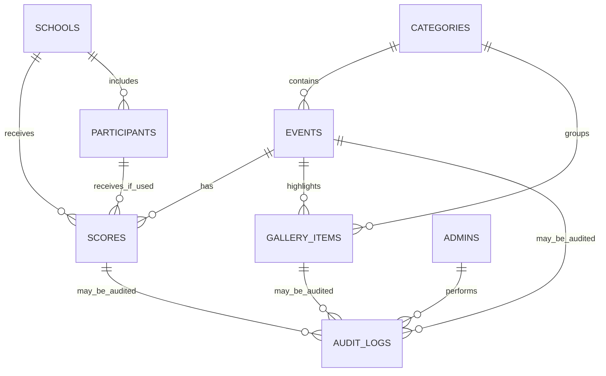

# Savvy Hunt — Database Design

**File:** `database.md`  
**Version:** 1.0  
**Status:** Proposed Convex database design  
**Last updated:** 28 October 2026  
**Related documents:** `plan.md`, `architectur.md`, `appflow.md`, `techspc.md`, `realtime-data-flow.md`

---

## 1. Purpose

This document defines the proposed database design for the Savvy Hunt website using **Convex**. It describes the tables, fields, relationships, indexes, validation rules, scoring calculations, publication behavior, audit trail, and Google Drive gallery metadata.

The database must support:

- Multiple schools competing across categories and events.
- Admin-entered event scores.
- School-wise and category-wise results.
- Live scoreboard and top-three updates through Convex reactive queries.
- Upcoming, live, completed, and result-published event information.
- Authorized admin management.
- Google Drive gallery synchronization and photo review/publication.
- Traceable score corrections and important admin actions.

This is a design proposal, not an already-deployed schema. Confirm the unresolved scoring and publication decisions in Section 16 before treating it as final.

## 2. Database principles

1. **Convex is the source of truth** for Savvy Hunt event data, score records, publication state, and gallery metadata.
2. **Store score records, not manually maintained leaderboard totals.** School totals and rankings are derived from eligible score records.
3. **Use backend mutations for every write.** Validate the user, references, state transitions, and points inside the mutation.
4. **Keep score changes and their audit entries consistent.** Write both in the same mutation where possible.
5. **Use stable IDs.** Google Drive files are identified by Drive file ID, not by file name.
6. **Separate operational status from publication status.** An event can be live but not published, or completed while its results are still provisional.
7. **Public queries return only public data.** Draft scores, admin records, audit history, and sync errors must not be exposed through public query functions.
8. **Do not store secrets in database documents.** Google OAuth secrets and refresh tokens belong in server-side secret storage.
9. **Avoid unnecessary personal data.** Only implement participant records if participant-level scoring is actually required.
10. **Use indexes for common lookups.** Do not load entire tables and filter in application code when an indexed query is appropriate.

---

## 3. Entity relationship overview



### Main entities

- **School:** a competing school.
- **Category:** a competition category.
- **Event:** one scheduled competition, belonging to a category.
- **Participant:** optional person/team display record if individual scoring is required.
- **Score:** points awarded for an event to a school or participant.
- **Admin:** an authorized identity allowed to manage the application.
- **Audit log:** record of important administrative changes.
- **Gallery item:** metadata and image-storage reference for a file imported from Google Drive.
- **Drive sync run:** operational record of a folder synchronization attempt.
- **App settings:** non-secret scoring, display, and integration settings.

---

## 4. Proposed tables

The following fields describe the logical model. The example schema in Section 5 provides a starting implementation. Convex-generated IDs are used for relationships unless a field explicitly stores an external identifier.

### 4.1 `schools`

Represents each competing school.

| Field | Type | Required | Purpose |
|---|---|---:|---|
| `name` | string | Yes | Official display name |
| `slug` | string | Yes | URL-safe stable identifier |
| `isActive` | boolean | Yes | Whether the school is available for new events/scores |
| `displayOrder` | number | Yes | Optional deterministic display order |
| `logoStorageId` | storage ID | No | Optional logo stored in Convex file storage |
| `createdAt` | number | Yes | Server timestamp in milliseconds |
| `updatedAt` | number | Yes | Server timestamp in milliseconds |
| `createdBy` | string | Yes | Auth provider subject / actor identifier |
| `updatedBy` | string | Yes | Last actor identifier |

**Rules:**
- Trim school names and reject empty names.
- Enforce slug uniqueness inside the mutation; Convex indexes are not ordinary SQL unique constraints.
- Prefer deactivation over hard deletion once a school has scores or historical results.
- Historical scores should remain attributable to the original school record.

### 4.2 `categories`

Represents categories such as debate, quiz, arts, or sports.

| Field | Type | Required | Purpose |
|---|---|---:|---|
| `name` | string | Yes | Category display name |
| `slug` | string | Yes | URL-safe identifier |
| `description` | string | No | Public description |
| `displayOrder` | number | Yes | Display ordering |
| `isActive` | boolean | Yes | Whether selectable for new events |
| `createdAt` / `updatedAt` | number | Yes | Timestamps |
| `createdBy` / `updatedBy` | string | Yes | Actor identifiers |

**Rules:**
- Validate a unique slug.
- Do not hard-delete categories that still have events. Archive/deactivate them instead.
- Category-level results are derived through events assigned to the category; category IDs do not need to be duplicated in each score record.

### 4.3 `events`

Represents a scheduled competition within a category.

| Field | Type | Required | Purpose |
|---|---|---:|---|
| `name` | string | Yes | Event name |
| `slug` | string | No | Optional human-readable route identifier |
| `categoryId` | ID of `categories` | Yes | Owning category |
| `description` | string | No | Public event description |
| `venue` | string | No | Venue/location |
| `startsAt` | number | No | Start timestamp in UTC milliseconds |
| `endsAt` | number | No | End timestamp in UTC milliseconds |
| `status` | enum string | Yes | Operational state |
| `publicationStatus` | enum string | Yes | Whether event information is public |
| `resultStatus` | enum string | Yes | Result readiness/finality |
| `resultsPublishedAt` | number | No | When results were last published/finalized |
| `createdAt` / `updatedAt` | number | Yes | Timestamps |
| `createdBy` / `updatedBy` | string | Yes | Actor identifiers |

Suggested values:

- `status`: `upcoming`, `live`, `paused`, `postponed`, `completed`, `cancelled`.
- `publicationStatus`: `draft`, `published`, `archived`.
- `resultStatus`: `not_ready`, `provisional`, `final`.

**Rules:**
- `categoryId` must refer to an existing category.
- If both schedule timestamps are present, `endsAt` must be greater than `startsAt`.
- Only an authorized admin can change event status or publication state.
- Do not automatically mark results as final just because an event end time has passed.
- A completed event may still have unpublished or provisional results.
- Use explicit, audited actions to reopen a completed/final event if that is permitted.

### 4.4 `participants` (optional)

Add this table only if events score individual participants or teams. For school-only scoring, it is not needed in version 1.

| Field | Type | Required | Purpose |
|---|---|---:|---|
| `displayName` | string | Yes | Minimum display label needed for the event |
| `schoolId` | ID of `schools` | Yes | Participant's school |
| `participantCode` | string | No | Optional event identifier; avoid sensitive data |
| `isActive` | boolean | Yes | Availability for new entries |
| `createdAt` / `updatedAt` | number | Yes | Timestamps |
| `createdBy` / `updatedBy` | string | Yes | Actor identifiers |

**Privacy rules:**
- Do not collect dates of birth, personal addresses, phone numbers, or other unnecessary student details.
- Only display participant names publicly if the school has approved that use.
- If a school/team rather than a person is the actual competition unit, name/model it accordingly rather than misusing a `participants` record.

### 4.5 `scores`

Stores points awarded in an event. The initial model supports school-level scores and can represent participant-level scores if that is confirmed.

| Field | Type | Required | Purpose |
|---|---|---:|---|
| `eventId` | ID of `events` | Yes | Event for which points are awarded |
| `targetType` | enum string | Yes | `school` or `participant` |
| `schoolId` | ID of `schools` | Yes | School to which the result is attributed |
| `participantId` | ID of `participants` | No | Required when target is an individual participant |
| `points` | number | Yes | Score value |
| `status` | enum string | Yes | `draft`, `published`, or `voided` |
| `note` | string | No | Optional explanation/comment |
| `revision` | number | Yes | Version counter for stale-update detection |
| `createdAt` / `updatedAt` | number | Yes | Timestamps |
| `createdBy` / `updatedBy` | string | Yes | Actor identifiers |

**Target consistency:**
- For a school-level score: `targetType = "school"`, `schoolId` is set, and `participantId` is omitted.
- For a participant-level score: `targetType = "participant"`, both `schoolId` and a valid `participantId` are set, and that participant belongs to the same school.
- Enforce these rules in every score mutation; the schema validator alone cannot express all cross-record consistency checks.

**Duplicate policy:**
- Decide whether a school/participant receives exactly one score per event or can receive multiple independent components.
- Recommended simple default: one score per event per target. Editing updates the existing record rather than creating a duplicate.
- If events have multiple scoring components, add a `componentKey` or a dedicated score-components table and include it in the duplicate key.
- Convex indexes accelerate lookup but do not act as declarative unique constraints. Use a deterministic key or a mutation-safe lookup/creation strategy to prevent duplicates.

**Score publication:**
- `draft`: admin-only; excluded from all public totals.
- `published`: eligible for public live standings if the event is published and the score is not voided.
- `voided`: excluded from totals but retained for traceability, or replaced by an explicit reversal record if the school prefers an immutable score ledger.

This model permits live results while retaining a draft workflow. The admin UI should clearly distinguish **Save draft** from **Save and publish** if both actions are offered.

### 4.6 `admins`

Stores the Savvy Hunt authorization allow-list. Authentication credentials remain with the external identity provider.

| Field | Type | Required | Purpose |
|---|---|---:|---|
| `authSubject` | string | Yes | Stable subject/user ID from the auth provider |
| `displayName` | string | No | Admin display name |
| `role` | enum string | Yes | Initially `admin`; may expand later |
| `isActive` | boolean | Yes | Enables/revokes application access |
| `createdAt` / `updatedAt` | number | Yes | Timestamps |
| `createdBy` / `updatedBy` | string | Yes | Actor identifiers, as applicable |

**Rules:**
- No public admin registration.
- Do not store passwords or authentication tokens here.
- Every admin query and mutation must verify the authenticated identity maps to an active admin record.
- Disabling the admin record must block protected application operations even if the identity-provider account still exists.
- An initial admin should be provisioned through a controlled process.

### 4.7 `auditLogs`

Records important administrative changes, especially score changes and result publication.

| Field | Type | Required | Purpose |
|---|---|---:|---|
| `entityType` | enum string | Yes | `school`, `category`, `event`, `score`, `galleryItem`, `admin`, `settings` |
| `entityId` | string | Yes | ID of the affected record, serialized as a string |
| `action` | string/enum | Yes | Operation performed |
| `actorSubject` | string | Yes | Authenticated actor identifier or trusted system actor |
| `oldPoints` | number | No | Previous score, for score changes |
| `newPoints` | number | No | New score, for score changes |
| `reason` | string | No | Correction explanation where required |
| `oldStatus` | string | No | Previous state when relevant |
| `newStatus` | string | No | New state when relevant |
| `createdAt` | number | Yes | Server timestamp |

Suggested actions include `created`, `updated`, `score_corrected`, `score_voided`, `status_changed`, `results_published`, `results_finalized`, `results_reopened`, `gallery_published`, `gallery_hidden`, and `admin_disabled`.

**Rules:**
- Create the score and score audit record in the same mutation wherever possible.
- Normal admin screens must not allow users to edit or delete audit records.
- Do not record tokens, secrets, or unnecessary personal information.
- For event/settings edits, add structured before/after fields as needed; do not depend on a single generic message for every type of audit detail.

### 4.8 `galleryItems`

Stores metadata for image files imported from the designated Google Drive folder.

| Field | Type | Required | Purpose |
|---|---|---:|---|
| `driveFileId` | string | Yes | Stable identifier from Google Drive |
| `driveFolderId` | string | Yes | Configured source folder identifier |
| `driveName` | string | Yes | Original file name for admin reference |
| `mimeType` | string | Yes | Detected/verified image MIME type |
| `driveModifiedTime` | string | No | Source modification time returned by Drive |
| `storageId` | ID of `_storage` | No | Copied file in Convex File Storage |
| `caption` | string | No | Public caption, if approved |
| `altText` | string | No | Accessible image description |
| `eventId` | ID of `events` | No | Associated event |
| `categoryId` | ID of `categories` | No | Optional category association |
| `status` | enum string | Yes | `pending_review`, `published`, `hidden`, `unavailable`, `sync_error` |
| `displayOrder` | number | No | Optional manual ordering |
| `lastSyncedAt` | number | No | Last successful sync time |
| `reviewedBy` | string | No | Reviewer identity |
| `publishedAt` | number | No | Publication time |
| `createdAt` / `updatedAt` | number | Yes | Timestamps |
| `syncErrorCode` | string | No | Safe error code, never a secret-bearing raw response |

**Rules:**
- Upsert by `driveFileId`, not by `driveName`.
- Only `published` items with a valid `storageId` may be returned from public gallery queries.
- The integration must confirm the file belongs to the approved source folder and is an allowed image type.
- Default to review-before-publish, particularly for school student photos.
- A private Drive URL must not be assumed to work for public visitors. Copy approved image bytes into application storage.
- Convex file URLs are bearer URLs: anyone who has the URL can access the file. Do not issue a public URL before approval. If a published item must be revoked, remove the stored file and reference according to the storage policy.

### 4.9 `driveSyncRuns`

Tracks Drive synchronization operations for troubleshooting and retries.

| Field | Type | Required | Purpose |
|---|---|---:|---|
| `trigger` | enum string | Yes | `scheduled` or `manual` |
| `status` | enum string | Yes | `running`, `success`, `partial`, `failed` |
| `startedAt` | number | Yes | Start timestamp |
| `finishedAt` | number | No | Completion timestamp |
| `filesSeen` | number | Yes | Number of files inspected |
| `filesAdded` | number | Yes | New items imported |
| `filesUpdated` | number | Yes | Existing items updated |
| `filesSkipped` | number | Yes | Unsupported/unchanged items |
| `safeErrorSummary` | string | No | Admin-visible safe summary |
| `createdBy` | string | No | Admin actor for manual run; absent for scheduled system run |

Keep raw credentials and token-bearing error payloads out of this table. A large sync should be paginated/resumable rather than expected to run indefinitely.

### 4.10 `appSettings`

Stores non-secret application configuration. A singleton key such as `global` may be used, or settings can be split by purpose.

Suggested settings:
- Event timezone (for example, `Asia/Kolkata`, if confirmed).
- Score minimum and maximum.
- Whether fractional/decimal points are allowed.
- Whether participant points contribute to school totals.
- Whether provisional results are public.
- Whether images require review before publication.
- Designated Google Drive folder ID.
- Public display options, such as showing zero-score schools.

Do **not** store Google OAuth client secrets, refresh tokens, or other credentials in this table. Store secrets in Convex server-side environment/secret configuration.

---

## 5. Example Convex schema

This starter code shows the table and index shape. It is not a complete application: cross-table rules, role checks, unique-value checks, and state transitions must be implemented inside backend mutations. Adjust optional fields after confirming the scoring model.

Create or adapt `convex/schema.ts`:

```ts
import { defineSchema, defineTable } from "convex/server";
import { v } from "convex/values";

const eventStatus = v.union(
  v.literal("upcoming"),
  v.literal("live"),
  v.literal("paused"),
  v.literal("postponed"),
  v.literal("completed"),
  v.literal("cancelled"),
);

const publicationStatus = v.union(
  v.literal("draft"),
  v.literal("published"),
  v.literal("archived"),
);

export default defineSchema({
  admins: defineTable({
    authSubject: v.string(),
    displayName: v.optional(v.string()),
    role: v.union(v.literal("admin")),
    isActive: v.boolean(),
    createdAt: v.number(),
    updatedAt: v.number(),
    createdBy: v.optional(v.string()),
    updatedBy: v.optional(v.string()),
  }).index("by_auth_subject", ["authSubject"]),

  schools: defineTable({
    name: v.string(),
    slug: v.string(),
    isActive: v.boolean(),
    displayOrder: v.number(),
    logoStorageId: v.optional(v.id("_storage")),
    createdAt: v.number(),
    updatedAt: v.number(),
    createdBy: v.string(),
    updatedBy: v.string(),
  })
    .index("by_slug", ["slug"])
    .index("by_active_display_order", ["isActive", "displayOrder"]),

  categories: defineTable({
    name: v.string(),
    slug: v.string(),
    description: v.optional(v.string()),
    displayOrder: v.number(),
    isActive: v.boolean(),
    createdAt: v.number(),
    updatedAt: v.number(),
    createdBy: v.string(),
    updatedBy: v.string(),
  })
    .index("by_slug", ["slug"])
    .index("by_active_display_order", ["isActive", "displayOrder"]),

  events: defineTable({
    name: v.string(),
    slug: v.optional(v.string()),
    categoryId: v.id("categories"),
    description: v.optional(v.string()),
    venue: v.optional(v.string()),
    startsAt: v.optional(v.number()),
    endsAt: v.optional(v.number()),
    status: eventStatus,
    publicationStatus,
    resultStatus: v.union(
      v.literal("not_ready"),
      v.literal("provisional"),
      v.literal("final"),
    ),
    resultsPublishedAt: v.optional(v.number()),
    createdAt: v.number(),
    updatedAt: v.number(),
    createdBy: v.string(),
    updatedBy: v.string(),
  })
    .index("by_category", ["categoryId"])
    .index("by_category_publication", ["categoryId", "publicationStatus"])
    .index("by_status_start", ["status", "startsAt"])
    .index("by_publication_start", ["publicationStatus", "startsAt"]),

  participants: defineTable({
    displayName: v.string(),
    schoolId: v.id("schools"),
    participantCode: v.optional(v.string()),
    isActive: v.boolean(),
    createdAt: v.number(),
    updatedAt: v.number(),
    createdBy: v.string(),
    updatedBy: v.string(),
  })
    .index("by_school", ["schoolId"])
    .index("by_school_active", ["schoolId", "isActive"]),

  scores: defineTable({
    eventId: v.id("events"),
    targetType: v.union(v.literal("school"), v.literal("participant")),
    schoolId: v.id("schools"),
    participantId: v.optional(v.id("participants")),
    points: v.number(),
    status: v.union(
      v.literal("draft"),
      v.literal("published"),
      v.literal("voided"),
    ),
    note: v.optional(v.string()),
    revision: v.number(),
    createdAt: v.number(),
    updatedAt: v.number(),
    createdBy: v.string(),
    updatedBy: v.string(),
  })
    .index("by_event", ["eventId"])
    .index("by_event_school", ["eventId", "schoolId"])
    .index("by_event_participant", ["eventId", "participantId"])
    .index("by_school", ["schoolId"])
    .index("by_status", ["status"]),

  auditLogs: defineTable({
    entityType: v.union(
      v.literal("school"),
      v.literal("category"),
      v.literal("event"),
      v.literal("score"),
      v.literal("galleryItem"),
      v.literal("admin"),
      v.literal("settings"),
    ),
    entityId: v.string(),
    action: v.string(),
    actorSubject: v.string(),
    oldPoints: v.optional(v.number()),
    newPoints: v.optional(v.number()),
    reason: v.optional(v.string()),
    oldStatus: v.optional(v.string()),
    newStatus: v.optional(v.string()),
    createdAt: v.number(),
  })
    .index("by_entity", ["entityType", "entityId"])
    .index("by_actor_time", ["actorSubject", "createdAt"])
    .index("by_created_at", ["createdAt"]),

  galleryItems: defineTable({
    driveFileId: v.string(),
    driveFolderId: v.string(),
    driveName: v.string(),
    mimeType: v.string(),
    driveModifiedTime: v.optional(v.string()),
    storageId: v.optional(v.id("_storage")),
    caption: v.optional(v.string()),
    altText: v.optional(v.string()),
    eventId: v.optional(v.id("events")),
    categoryId: v.optional(v.id("categories")),
    status: v.union(
      v.literal("pending_review"),
      v.literal("published"),
      v.literal("hidden"),
      v.literal("unavailable"),
      v.literal("sync_error"),
    ),
    displayOrder: v.optional(v.number()),
    lastSyncedAt: v.optional(v.number()),
    reviewedBy: v.optional(v.string()),
    publishedAt: v.optional(v.number()),
    createdAt: v.number(),
    updatedAt: v.number(),
    syncErrorCode: v.optional(v.string()),
  })
    .index("by_drive_file", ["driveFileId"])
    .index("by_status", ["status"])
    .index("by_status_display_order", ["status", "displayOrder"])
    .index("by_event", ["eventId"])
    .index("by_category", ["categoryId"]),

  driveSyncRuns: defineTable({
    trigger: v.union(v.literal("scheduled"), v.literal("manual")),
    status: v.union(
      v.literal("running"),
      v.literal("success"),
      v.literal("partial"),
      v.literal("failed"),
    ),
    startedAt: v.number(),
    finishedAt: v.optional(v.number()),
    filesSeen: v.number(),
    filesAdded: v.number(),
    filesUpdated: v.number(),
    filesSkipped: v.number(),
    safeErrorSummary: v.optional(v.string()),
    createdBy: v.optional(v.string()),
  })
    .index("by_started_at", ["startedAt"])
    .index("by_status_started_at", ["status", "startedAt"]),

  appSettings: defineTable({
    key: v.string(),
    eventTimezone: v.optional(v.string()),
    minimumPoints: v.optional(v.number()),
    maximumPoints: v.optional(v.number()),
    allowDecimalPoints: v.optional(v.boolean()),
    participantPointsContributeToSchoolTotal: v.optional(v.boolean()),
    showZeroScoreSchools: v.optional(v.boolean()),
    provisionalResultsPublic: v.optional(v.boolean()),
    galleryRequiresReview: v.optional(v.boolean()),
    driveFolderId: v.optional(v.string()),
    updatedAt: v.number(),
    updatedBy: v.string(),
  }).index("by_key", ["key"]),
});
```

### Notes on this starter schema

- If participant scoring is confirmed unnecessary, remove `participants` and the optional participant path from `scores` to simplify the first version.
- If admins must have separate roles, expand the `admins.role` validator and authorize each mutation accordingly.
- Keep table names, validators, and index definitions in sync with the code that queries them.
- The example uses numeric timestamps in milliseconds for consistency. Convert to readable local dates only in UI code.
- The code does not make slug, Drive file ID, or score target unique automatically. Mutations must implement those constraints safely.
- Check the selected Convex SDK version and generated types during setup; the project should compile and run schema validation before seed data is added.

---

## 6. Index and query design

Convex indexes should reflect the queries used by the public pages and admin dashboard.

| Query use case | Table/index to use | Notes |
|---|---|---|
| Find admin by authenticated identity | `admins.by_auth_subject` | Verify `isActive` and role on every protected call |
| Look up a school by slug | `schools.by_slug` | Check slug uniqueness in mutations |
| List active schools in display order | `schools.by_active_display_order` | Suitable for admin score target selectors |
| List categories in display order | `categories.by_active_display_order` | Filter active categories in the query |
| List events in a category | `events.by_category` | Also filter by publication state as required |
| List public schedule by status/time | `events.by_status_start` or `events.by_publication_start` | Use an index that matches the actual filter/order combination |
| Load scores for an event | `scores.by_event` | Used by event result calculation |
| Load a school's scores | `scores.by_school` | Used for school total calculations if appropriate |
| Find existing score for an event/school | `scores.by_event_school` | Used by create/update mutation to avoid accidental duplicates |
| Find an imported Drive file | `galleryItems.by_drive_file` | Supports idempotent upsert by file ID |
| List public gallery entries | `galleryItems.by_status_display_order` | Query only `published` records, then generate safe public image URLs |
| Inspect a specific entity's audit history | `auditLogs.by_entity` | Admin-only |
| Review Drive sync health | `driveSyncRuns.by_started_at` | Admin-only operational information |

Indexes improve access efficiency; they do not replace authorization, input validation, uniqueness checks, or publication filters.

---

## 7. Score calculations and publication rules

### 7.1 Canonical data

The `scores` table is the canonical record of points. Do not persist a manually editable school total unless a later, measured performance requirement justifies a derived summary/cache with reconciliation tests.

### 7.2 Proposed default school total

Until the school confirms the participant rule, use school-level published scores only:

```text
schoolTotal(school) = sum(points)
  for non-voided, published scores attributed to that school
  whose events are published and eligible for public standings
  and whose targetType is "school"
```

If participant scores should contribute to school totals, update the formula to include participant-target scores where the participant's `schoolId` matches the school. Make this a single setting or clearly defined business rule, not a per-page assumption.

### 7.3 Category results

For a category, retrieve its events and eligible scores for those events. The score belongs to an event, and the event belongs to a category. Do not store a duplicate `categoryId` on every score unless profiling demonstrates a real query need and the duplication is kept consistent.

### 7.4 “Who's Leading?”

- Calculate school totals using the same eligibility rules as the school scoreboard.
- Sort by points descending.
- Recommended default: equal totals share a rank.
- A deterministic order such as school name may be used for display inside a tie, but that order must not imply a competitive tie-breaker.
- Return up to three schools; do not invent entries when fewer than three schools have eligible results.
- Decide whether schools with zero published points should appear.

### 7.5 Live and final results

A practical version-one behavior is:

- Draft scores are private to admins.
- Published scores can feed a live/provisional scoreboard for published events.
- An event's official winner/result page shows “final” only when an authorized admin finalizes results.
- The top-three display may be labelled “Live standings” if the underlying results remain provisional.
- If the school wants only final scores to be public, change the query eligibility rule before launch.

### 7.6 Score correction

A score correction mutation should:

1. Verify the active admin identity.
2. Load the score and event.
3. Verify that the current revision matches the revision submitted by the editor.
4. Validate the new points and whether the result is editable in its current state.
5. Update the score and increment the revision.
6. Write an audit record with actor, time, previous points, new points, and reason when required.
7. Commit the changes together.
8. Return success only after the mutation succeeds. Convex reactive queries then update connected viewers.

---

## 8. Data integrity and mutation responsibilities

### School and category mutations

- Trim and validate names.
- Check slug conflicts before creation/update.
- Prefer archive/deactivate over hard deletion once referenced by historical records.
- Record who changed key records and when.

### Event mutations

- Verify category existence.
- Validate start/end timestamps.
- Validate status transitions rather than accepting an arbitrary status string.
- Require an explicit confirmation or special mutation to reopen completed/final results.
- Write an audit entry for publication and major state changes.

### Score mutations

- Verify admin access using the server-validated identity.
- Validate event, school, and participant references.
- Verify that `targetType` matches the presence/absence of `participantId`.
- Verify that a participant belongs to `schoolId`.
- Validate finite score values and configured limits.
- Check existing record by event and target before inserting a new record.
- Use a revision/version check to protect against stale editing where practical.
- Save the audit entry in the same mutation.
- Do not trust client-provided rank, total, publication eligibility, or actor ID.

### Gallery mutations

- Only an authorized admin can publish/hide a gallery item.
- Only validated image files from the designated folder may be ingested.
- Ensure `driveFileId` is upserted instead of duplicated.
- Only return `published` items with a valid storage reference from public queries.
- Removing a gallery item from public visibility should update Convex metadata immediately; removing actual file bytes from storage is a separate operation when required.

### Settings mutations

- Restrict to an authorized admin.
- Validate point ranges (`minimumPoints <= maximumPoints`).
- Prevent client users from changing integration settings through public interfaces.
- Store only non-secret configuration values in `appSettings`.

---

## 9. Realtime query behavior

Convex reactive queries subscribe to data used by public components.

When an admin updates a published score:

1. The score mutation commits the score update and audit record.
2. Convex detects that relevant query results may have changed.
3. `getSchoolLeaderboard`, the selected `getCategoryResults`, and `getTopThreeSchools` queries recompute/update for subscribed clients.
4. React receives updated query values and re-renders the affected components without a full page refresh.

The data must be consistently filtered in all public queries. A score must not appear in a category result but be omitted from the school total because those pages implemented different inclusion rules.

Example query contract:

```ts
// Illustrative signature only; implement using current Convex API and indexes.
// Public query returns published standings only; do not return raw admin fields.
getSchoolLeaderboard(): Array<{
  schoolId: Id<"schools">;
  schoolName: string;
  points: number;
  rank: number;
}>;
```

Do not use a timer or browser polling loop to refresh scoreboards. Drive uploads are a separate integration: a scheduled backend sync must first detect and import an image, after which Convex reactivity can update the gallery.

---

## 10. Admin authorization and data visibility

### Admin identity check

Use the authentication provider's verified identity in Convex. Resolve the identity's subject using the `admins.by_auth_subject` index, then require `isActive === true` and an allowed role. Never trust a client-supplied `actorId` as proof of identity.

### Public data access

Public queries may return:
- Active schools and approved names/logos.
- Public categories and published events.
- Published scores/results allowed by the result policy.
- Derived standings and top-three entries.
- Published, available gallery items and their public image URLs.

Public queries must not return:
- Draft or voided score data.
- Audit history.
- Admin allow-list records.
- Google OAuth credentials, Drive access tokens, or internal folder sync error payloads.
- Pending-review or hidden gallery items.
- Participant information that has not been approved for public display.

### Authentication provider note

Use a supported identity provider integrated with Convex (for example, Clerk after validating current provider documentation). Authentication confirms identity; the `admins` table/allow-list confirms Savvy Hunt administrative authorization.

---

## 11. Google Drive gallery data lifecycle

1. An organizer uploads a photo to the designated Drive folder.
2. A scheduled backend sync lists files and reads metadata through the Google Drive API.
3. The sync validates folder membership, file ID, MIME type, size, and modified time.
4. It checks `galleryItems.by_drive_file` and performs an idempotent insert/update.
5. Eligible bytes are downloaded server-side and copied into Convex File Storage.
6. The gallery item is saved as `pending_review` by default.
7. An admin checks the photo, caption, alt text, and event/category association.
8. On approval, the item becomes `published`; the public gallery query may return it.
9. Convex reactive queries update connected gallery clients after the metadata change.
10. A reconciliation pass handles source files that were moved, deleted, or made inaccessible.

### Sync requirements

- Use a dedicated folder and least-privilege Drive permissions.
- Store OAuth credentials in server-side environment/secret storage, never in Convex documents or browser code.
- Use Drive file ID for idempotency.
- Support API pagination and bounded retries.
- Record safe sync-run summaries for admins.
- Do not allow a public visitor to trigger an unrestricted sync.
- A several-minute delay may occur between Drive upload and the review queue; the exact schedule is an operational decision.
- Review-before-publication is the default because the gallery may include students.

---

## 12. Timestamp and naming conventions

- Store timestamps as Unix epoch **milliseconds** in numeric Convex fields, consistently throughout this app.
- Store Google Drive's returned `modifiedTime` as an ISO/string field if retaining the original representation; convert only when needed for calculations.
- Use `createdAt`, `updatedAt`, and `lastSyncedAt` consistently.
- Convert UTC event timestamps to the configured event timezone only for display. Do not store ambiguous local time strings as the authoritative schedule.
- Use `isActive` for an entity's selection status, `status` for workflow state, and `publicationStatus` for public visibility. Avoid reusing one field to mean several things.
- Use stable slugs for routes, but always use Convex IDs for database relationships.

---

## 13. Retention and deletion policy

Recommended baseline:

- Retain historical school/category/event/score relationships so past results remain consistent.
- Archive or deactivate entities rather than deleting them when referenced by score records.
- Keep audit logs according to a retention policy set by the school.
- If an image is removed from public display, set its gallery status to `hidden` or `unavailable` and remove the stored file when required by the removal policy.
- Do not retain unnecessary participant personal data.
- Define how long historical event pages and gallery items should remain public after Savvy Hunt ends.

Hard deletion must be deliberate. Deleting a source image in Google Drive does not automatically delete a copied image stored in Convex File Storage; the reconciliation workflow must implement the agreed behavior.

---

## 14. Testing requirements

### Schema and validation

- Reject empty school/category/event names.
- Reject a score with a missing/invalid event or school reference.
- Reject participant-target scores without a valid participant or with a participant from another school.
- Reject non-finite/out-of-range points.
- Verify event timestamps and status transitions.
- Verify Drive file ID uniqueness behavior at the mutation level.

### Authorization and visibility

- An unauthenticated caller cannot perform admin mutations.
- An authenticated but non-admin caller cannot perform admin mutations.
- An inactive admin cannot perform protected operations.
- Draft/voided scores are absent from public standings.
- Pending-review and hidden gallery items are absent from public queries.
- Audit and sync error data is accessible only to authorized admins.

### Score integrity and reactivity

- Score update plus audit record commits consistently.
- Duplicate submissions do not unintentionally create duplicate score records.
- Stale revisions are rejected if version checking is enabled.
- School totals, category results, and top-three rankings use the same scoring rules.
- A committed score update changes the subscribed query result without manual refresh.
- Ties, zero-score schools, fewer than three schools, and unpublished results behave according to the approved rules.

### Drive sync

- Re-syncing the same Drive file does not create duplicate gallery entries.
- Unsupported types and oversized files are rejected.
- Transient API failure is recorded safely and can be retried.
- New items remain private until approval under the default policy.
- Hidden/unavailable items disappear from public gallery results.

---

## 15. Recommended build order

1. Confirm school-level versus participant-level scoring and aggregation.
2. Confirm tie policy and result publication policy.
3. Implement `schools`, `categories`, `events`, and `scores` schema with indexes.
4. Implement admin allow-list and authorization helper.
5. Implement event mutations and state-transition checks.
6. Implement score create/update/correction mutations with audit logging.
7. Implement public school leaderboard, category result, event, and top-three queries.
8. Verify reactive updates with multiple browser sessions.
9. Add gallery metadata, Drive sync, file storage, and review/publication workflow.
10. Add sync status, retention behavior, and complete automated tests.

Do not start with a cached leaderboard table or a complex multi-role admin system unless load testing or confirmed requirements justify it.

---

## 16. Decisions required before final schema approval

1. **Scoring target:** Are points entered for schools only, individuals/teams only, or both depending on event?
2. **Aggregation:** If participant points exist, do they contribute to school totals and the top-three leaderboard?
3. **Score uniqueness:** Is there one score per event per school/participant, or can an event have multiple score components?
4. **Point validation:** Are decimals or negative/bonus points allowed? What are the accepted bounds?
5. **Tie policy:** Shared rank, tie-breaker, or admin decision?
6. **Public visibility:** Should a score become public immediately when saved, or must the admin explicitly publish it?
7. **Result finality:** Are provisional results public, and can final results be reopened?
8. **Zero-score schools:** Show every active school, or only schools with published scores?
9. **Admin roles:** Is one `admin` role enough for the first release?
10. **Google Drive privacy:** Will approved images be public copies while source files remain private?
11. **Photo moderation:** Must every new photo be approved before publication?
12. **Retention:** How long should results, audit logs, and gallery images be kept?
13. **Expected scale:** Number of schools, categories, events, gallery images, admins, and peak viewers?

### Recommended defaults

- Start with school-level scoring. Add participants only if needed.
- One score per event per scoring target unless the format requires components.
- Use published score records for live standings; allow admins to save drafts separately.
- Calculate totals from canonical score records.
- Share equal ranks unless the organizers approve a tie-breaker.
- Keep a full audit trail for score corrections.
- Automatically sync Drive images into a pending review queue.
- Publish only approved gallery items.

---

## 17. Official documentation to consult

Use current documentation when implementing because APIs and plan limits can change:

- Convex documentation: https://docs.convex.dev/
- Convex schema and validators: https://docs.convex.dev/database/schemas
- Convex indexes: https://docs.convex.dev/database/reading-data/indexes/
- Convex file storage: https://docs.convex.dev/file-storage/overview
- Convex authentication: https://docs.convex.dev/auth/overview
- Google Drive API file listing: https://developers.google.com/workspace/drive/api/guides/search-files
- Google Drive API downloads: https://developers.google.com/workspace/drive/api/guides/manage-downloads

---

**Database design acceptance gate:** before production, validate the schema against real event examples, confirm the scoring aggregation and tie rules, test all admin authorization paths, and prove that a saved/published score updates school totals, category results, and the top-three leaderboard consistently.
