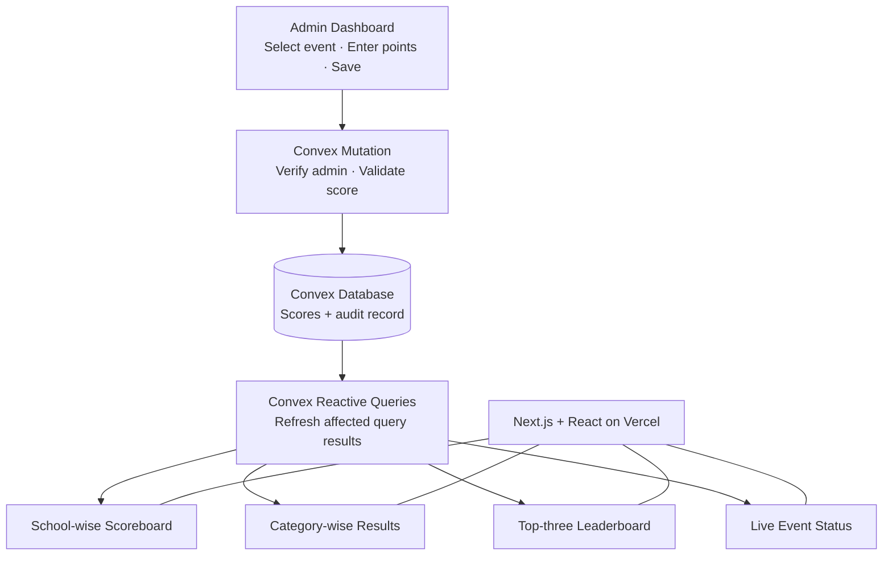

# Savvy Hunt: Real-Time Data Flow and Update Mechanism

The Savvy Hunt website will use **Convex reactive queries** to keep the school-wise scoreboard, category-wise results, and “Who's Leading?” top-three leaderboard synchronized with admin score changes. When an authorized admin saves a score, connected viewers receive the updated data automatically, without manually refreshing the page.

## 1. System architecture



The stack is **Next.js + React + TypeScript + Convex + Vercel**. Vercel hosts the web application, while Convex manages score data, backend operations, and live subscriptions.

## 2. Step-by-step update flow

1. **An admin enters a score.** The admin selects an event and school, enters the points, and clicks **Save** in the admin dashboard.
2. **Convex validates the request.** A backend mutation verifies that the admin is authorized, the event and school exist, the score is valid, and the event permits the change. It writes the score and its audit record together.
3. **The database change is committed.** Convex confirms that the mutation succeeded. The admin interface displays success only after this confirmation.
4. **Reactive queries update.** Convex tracks the database data read by active queries. When a committed change affects a query's result, Convex updates that query result for subscribed clients.
5. **React updates the page.** Components using Convex query hooks receive the new results and render updated points, ranks, and leaderboard entries automatically.

This avoids manual polling and asking users to reload the page.

## 3. How each live view updates

| Website component | What the query calculates | What viewers see |
|---|---|---|
| School-wise scoreboard | Eligible published points grouped by school | Updated totals, ranks, and school ordering |
| Category-wise results | Published scores for events in the selected category | Updated category standings |
| “Who's Leading?” | Overall totals ranked according to the approved ranking rule | The current top three schools |
| Live event status | Published event details and current status | Changes to upcoming, live, or completed states |

All these views should use the same scoring and publication rules. Draft scores must not appear in public rankings unless organizers explicitly decide to publish provisional results.

## 4. Example: a score changes

Suppose the current scoreboard is:

| Rank | School | Points |
|---:|---|---:|
| 1 | School A | 120 |
| 2 | School B | 110 |
| 3 | School C | 95 |

An authorized admin adds 15 points to School B. After the mutation commits, the updated leaderboard becomes:

| Rank | School | Points |
|---:|---|---:|
| 1 | School B | 125 |
| 2 | School A | 120 |
| 3 | School C | 95 |

The connected scoreboard reorders automatically. The top-three section and any affected category results also update, provided those views include the changed score. The browser does not need to reload the whole page: Convex updates subscribed data and React rerenders the dependent components.

## 5. Recommended query structure

Use separate queries for each public view, while sharing the same central scoring rules.

```text
convex/
├── public/
│   ├── getSchoolLeaderboard.ts
│   ├── getCategoryResults.ts
│   ├── getTopThreeSchools.ts
│   └── getLiveEvents.ts
├── admin/
│   ├── createScore.ts
│   └── updateScore.ts
├── shared/
│   └── scoring.ts
└── schema.ts
```

These filenames are suggestions; the code can be organized differently if the responsibilities remain clear.

### Example React component

A React component can subscribe to a public Convex query using `useQuery`:

```tsx
"use client";

import { useQuery } from "convex/react";
import { api } from "@/convex/_generated/api";

export function SchoolLeaderboard() {
  const schools = useQuery(
    api.public.getSchoolLeaderboard
  );

  if (schools === undefined) {
    return <p>Loading scoreboard...</p>;
  }

  if (schools.length === 0) {
    return <p>No published results yet.</p>;
  }

  return (
    <ol>
      {schools.map((school) => (
        <li key={school.schoolId}>
          {school.rank}. {school.schoolName} — {school.points} points
        </li>
      ))}
    </ol>
  );
}
```

This example assumes the query returns `schoolId`, `rank`, `schoolName`, and `points`. The actual query and schema must define these fields.

**Important:** `useQuery` subscribes reactively. Do not put the leaderboard in a timer that calls the backend every few seconds just to simulate live updates.

## 6. Performance and correctness rules

- **Use one source of truth.** Store event-level score records and calculate totals from eligible records. Do not maintain a separate manually edited leaderboard total.
- **Use database indexes.** Query scores by event, school, and category through suitable indexes instead of scanning unrelated data.
- **Centralize ranking logic.** Define totals, publication eligibility, tie handling, and top-three selection consistently.
- **Protect writes on the backend.** Frontend checks alone cannot prevent unauthorized score changes.
- **Handle simultaneous edits.** If two admins edit the same score, detect stale revisions or apply an explicit conflict policy.
- **Handle disconnections.** Show a connection/freshness warning when needed and allow the reactive subscription to recover.
- **Avoid false success states.** A score is not authoritative until the mutation succeeds.
- **Measure before optimizing.** If aggregation becomes expensive, consider a carefully maintained summary structure with consistency tests.

For a school-event workload, reactive queries are a strong starting point. Test the system with realistic numbers of schools, events, scores, and concurrent viewers before launch.

## 7. Real-time updates versus Google Drive updates

These are separate flows:

- **Scoreboards and event statuses:** Convex database updates trigger reactive query updates to connected viewers.
- **Google Drive photos:** A server-side sync process must first detect the uploaded image and update Convex. The gallery then updates reactively after its metadata is committed and the image is approved for publication.

Convex cannot detect a new Drive file by itself. The delay between uploading a photo and seeing it in the review queue depends on the configured Drive synchronization method and schedule.

## 8. Expected result

During Savvy Hunt, an authorized admin can enter scores from one device while students, teachers, and visitors watch the public website on other devices. After the score mutation commits, Convex updates the relevant subscriptions and the page renders the new school totals, category standings, and top-three leaderboard **without a manual refresh**.
