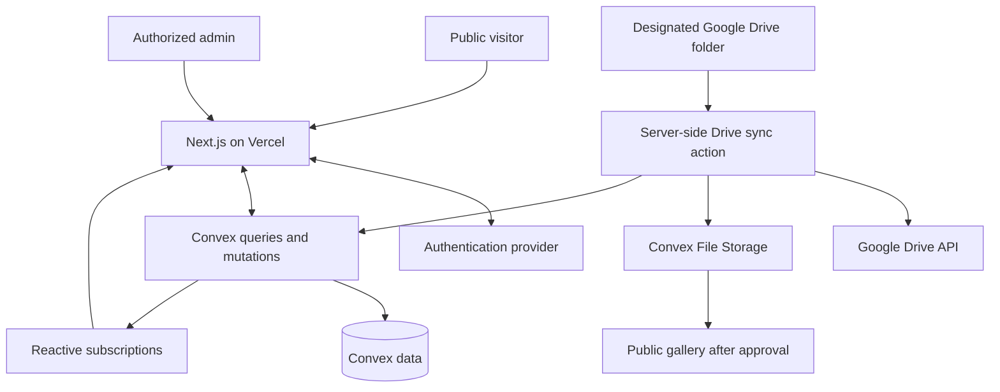
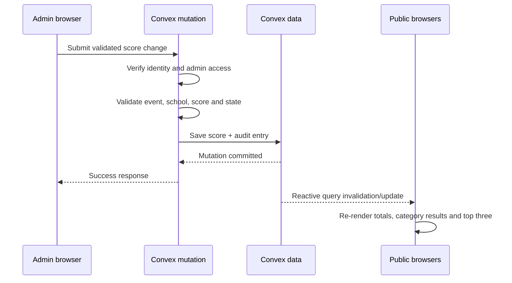

# Savvy Hunt — Technical Specification

**File:** `techspc.md`  
**Version:** 1.0  
**Status:** Draft for implementation  
**Last updated:** 28 October 2026  
**Related documents:** `plan.md`, `architectur.md`, `appflow.md`

---

## 1. Purpose

This document defines the implementation-level technical requirements for the Savvy Hunt event website. It complements:

- `plan.md` — product scope and implementation phases.
- `architectur.md` — high-level system architecture.
- `appflow.md` — page and workflow behavior.
- `techspc.md` — technical decisions, data contracts, validation, security, and acceptance requirements.

The first release will support multiple competing schools, categories, and events; admin-entered scores; public school-wise and category-wise results; reactive live score updates; an event schedule; a top-three “Who's Leading?” section; and a photo gallery populated from Google Drive.

## 2. Status and assumptions

### Confirmed requirements

- Hosting target: Vercel.
- Main database and reactive backend: Convex.
- Frontend: recommend Next.js, React, and TypeScript.
- Event model: multiple schools compete across categories and events.
- Scoring: admins manually enter points.
- Live updates: public pages update without manual refresh.
- Admin access: authenticated, authorized admins only.
- Gallery source: a designated Google Drive folder; uploaded images should reach the website.

### Defaults used by this specification

The following are proposed defaults, not confirmed business rules:

1. Public pages do not require login.
2. The admin dashboard has no public self-registration.
3. New Google Drive images sync automatically but are not public until an admin approves them.
4. Only published results appear on public pages.
5. Totals are calculated from event-level score records; admins do not directly edit aggregate totals.
6. Equal totals share a rank until a tie-break policy is agreed.
7. One general `admin` role is enough for the first release.
8. Participant tracking is optional. The first implementation should support school-level score targets and should not collect participant details unless needed.
9. Google Drive is the upload/source-of-record location for images; approved images are copied into controlled public image storage.
10. The initial Google Drive integration uses scheduled synchronization and reconciliation, not a real-time guarantee.

If any default differs from the school’s rules, update this document before implementation.

---

## 3. Required technology

| Layer | Technology | Requirement |
|---|---|---|
| Web framework | Next.js App Router | Use a supported stable version and pin versions through the package manager lockfile |
| Language | TypeScript | Enable strict mode |
| UI | React | Use Server Components by default; mark interactive components as client components |
| Styling | Tailwind CSS | Use design tokens and responsive breakpoints consistently |
| UI primitives | Accessible primitives / shadcn/ui where useful | Avoid building inaccessible controls from scratch |
| Backend/database | Convex | All authoritative event, score, and publication state resides here |
| Live updates | Convex reactive queries | Do not implement manual polling for scoreboards |
| Authentication | Clerk integrated with Convex, or another verified provider | Choose one provider before implementation; see Section 13 |
| Image source | Google Drive API v3 | Read a configured folder on the server/backend only |
| Public image storage | Convex File Storage for MVP, subject to file/usage limits | Copy approved image bytes into controlled application storage; never depend on private Drive preview URLs |
| Validation | Convex validators and shared TypeScript/Zod schemas where appropriate | Validate at trust boundaries and on all mutations |
| Testing | Vitest, React Testing Library, Playwright | Cover calculations, permissions, and critical user flows |
| Version control | GitHub | Use pull requests or an equivalent review process |
| Hosting | Vercel | Separate preview and production configuration |

### 3.1 Non-goals

Do not add these unless explicitly approved:
- Payments, registrations, ticketing, or attendance.
- Public accounts for students or visitors.
- Automatic scoring or judge-device integrations.
- A separate REST API server when Convex functions cover the requirements.
- A separate realtime infrastructure when Convex subscriptions meet the expected event scale.
- Complex role-based access control before the school needs it.

### 3.2 Dependency policy

- Pin exact versions in the lockfile.
- Avoid installing duplicate UI, form, or date libraries without a clear need.
- Review dependencies for maintenance, license, vulnerabilities, and bundle size.
- Keep secrets and server-only dependencies out of client bundles.
- Run type checking, linting, and tests before production deployment.

---

## 4. System boundaries

### 4.1 Components

**Next.js on Vercel**
- Renders public pages and admin UI.
- Provides routing, layouts, loading states, metadata, and responsive presentation.
- Uses Convex client queries for reactive views.
- Must not be the authoritative source for scores or admin permissions.

**Convex**
- Stores schools, categories, events, score records, publication state, gallery metadata, and audit events.
- Validates and authorizes mutations.
- Calculates or queries totals and rankings.
- Delivers reactive results to subscribed clients.
- Runs server-side actions to integrate with Google Drive, subject to Convex runtime/API limits.

**Authentication provider**
- Authenticates admin identities.
- Issues a verified identity/token that Convex can validate.
- Does not automatically make every signed-in user an admin; admin authorization is an explicit application check.

**Google Drive**
- Allows the designated organizer to upload image files.
- Is not the application database and must not store score state.
- Is read by the integration using server-side credentials/scopes.

**Convex File Storage**
- Receives approved image file bytes for public delivery.
- Stores a storage ID and metadata reference in Convex.
- A generated file URL behaves like a bearer URL: anyone with the URL may access it. Do not issue public URLs before approval, and delete the stored file to revoke a published URL when removal is required. See the official Convex File Storage documentation.

### 4.2 Data flow



### 4.3 Trust boundaries

- Browser input is untrusted.
- Every admin mutation must verify identity and admin permission.
- Public queries must return published public information only.
- Google Drive API credentials must never be sent to the browser.
- File names, captions, descriptions, and metadata from Drive are untrusted input.
- A generated public image URL is effectively shareable; moderation must occur before publication.
- Vercel preview deployments must use non-production data and credentials.

---

## 5. Functional modules

1. Public home and event overview.
2. School-wise scoreboard.
3. Category-wise scoreboard.
4. Live event status and schedule.
5. Event detail, published results, and winners.
6. “Who's Leading?” top-three schools.
7. Snapshot/photo gallery.
8. Admin authentication and authorization.
9. Event creation and editing.
10. Score entry and correction.
11. Results review/publication.
12. Google Drive synchronization.
13. Gallery review and publishing.
14. Audit history and operational status.

Every module must have loading, empty, error, and permission-denied handling where applicable.

---

## 6. Routing requirements

### 6.1 Public routes

| Route | Purpose | Data access |
|---|---|---|
| `/` | Live overview, top three, schedule preview, latest gallery items | Published data only |
| `/scoreboard` | School-wise standings | Published scores and derived totals |
| `/scoreboard/categories` | Category selector | Published categories/results |
| `/scoreboard/categories/[slug]` | One category's results | Published category results |
| `/schedule` | Upcoming/live/completed event lists | Published event data |
| `/events/[eventId]` | Event details and published result | Published event details |
| `/gallery` | Approved photos and highlights | Published gallery items |

### 6.2 Admin routes

| Route | Purpose |
|---|---|
| `/admin/login` | Admin sign-in |
| `/admin` | Admin overview |
| `/admin/events` | Event list and status |
| `/admin/events/new` | Create an event |
| `/admin/events/[eventId]` | Edit event details |
| `/admin/scores` | Enter and correct scores |
| `/admin/results` | Review and publish results |
| `/admin/gallery` | Review and manage synced images |
| `/admin/settings` | Restricted configuration and sync health |

Server-rendered route protection is useful for the user experience but is not the security boundary. The backend must still authorize every protected operation.

---

## 7. Convex data model

The schema below is logical, not copy-paste code. Implement tables and validators in `convex/schema.ts` and keep field types explicit.

### 7.1 `schools`

| Field | Type | Notes |
|---|---|---|
| `name` | string | Required, trimmed |
| `slug` | string | Stable URL-safe identifier; unique by application validation |
| `logoStorageId` | optional storage ID | Optional logo hosted in Convex storage |
| `isActive` | boolean | Inactive schools are hidden from new entry forms unless historical data needs them |
| `displayOrder` | number | Optional display ordering |
| `createdAt` / `updatedAt` | number | Server timestamps |
| `createdBy` / `updatedBy` | user ID or provider subject | Authenticated admin |

### 7.2 `categories`

Fields:
- `name: string`
- `slug: string`
- `description?: string`
- `displayOrder: number`
- `isActive: boolean`
- `createdAt`, `updatedAt`
- `createdBy`, `updatedBy`

Names/slugs must be unique according to the agreed rules. Do not hard-delete categories that have historical events; prefer archival.

### 7.3 `events`

Fields:
- `name: string`
- `slug?: string`
- `categoryId: Id<"categories">`
- `description?: string`
- `venue?: string`
- `startsAt?: number`
- `endsAt?: number`
- `status: "upcoming" | "live" | "paused" | "postponed" | "completed" | "cancelled"`
- `publicationStatus: "draft" | "published" | "archived"`
- `resultStatus: "not_ready" | "provisional" | "final"` or an equivalent validated representation
- `resultsPublishedAt?: number`
- `createdAt`, `updatedAt`
- `createdBy`, `updatedBy`

Validation:
- Required name and category.
- If both times exist, end must be later than start.
- Category must exist and be active for new events.
- Only admins may alter event state.
- Changing a completed/final event should require an intentional action and create an audit entry.

### 7.4 `scores`

The first release should support school targets. If a participant-specific scoring format is confirmed, add a `participants` table and make the target model explicit rather than storing ambiguous optional values.

Fields:
- `eventId: Id<"events">`
- `schoolId: Id<"schools">`
- `points: number`
- `note?: string`
- `publicationStatus: "draft" | "published"` or derived from the event result state, but choose one model and use it consistently
- `createdAt`, `updatedAt`
- `createdBy`, `updatedBy`
- Optional `revision` or version number for stale-write detection

Requirements:
- Points must be finite numbers.
- Enforce the configured minimum/maximum and decimal/whole-number rule.
- Do not accept `NaN`, infinity, or unbounded values.
- Decide whether there is one score per event per school or whether scores have multiple components.
- Use a database index for common lookups by event and by school.
- Avoid storing a manually edited school total in this table.

**Uniqueness:** Convex does not provide ordinary relational unique constraints. Enforce the desired uniqueness rule in mutations and indexes; if concurrency can create duplicates, use a deterministic score key or another safe conflict-prevention approach.

### 7.5 `scoreAuditLog`

Fields:
- `entityType: "score" | "event" | "result"`
- `entityId: string`
- `action: "created" | "updated" | "deleted" | "published" | "finalized" | "reopened"`
- `oldValue?: object`
- `newValue?: object`
- `reason?: string`
- `actorId: string`
- `createdAt: number`

Audit requirements:
- Create the score change and its audit record in one mutation.
- Do not allow normal admin UI paths to modify or delete audit entries.
- Avoid storing secrets or unnecessary student data in audit payloads.
- Require a correction reason when the school approves that policy; at minimum, capture before/after values and actor.

### 7.6 `galleryItems`

Fields:
- `driveFileId: string`
- `driveName: string`
- `mimeType: string`
- `driveModifiedTime?: string`
- `driveFolderId: string`
- `storageId?: Id<"_storage">`
- `caption?: string`
- `altText?: string`
- `eventId?: Id<"events">`
- `categoryId?: Id<"categories">`
- `status: "pending_review" | "published" | "hidden" | "unavailable" | "sync_error"`
- `createdAt`, `updatedAt`
- `lastSyncedAt?: number`
- `reviewedBy?: string`
- `publishedAt?: number`
- `syncErrorCode?: string` (safe code; not raw secret-bearing error text)

Requirements:
- Upsert by `driveFileId`; do not use name as identity.
- Only `published` items with a valid storage ID may be returned to the public gallery.
- Keep Drive credentials out of this table.
- Captions and alt text must be escaped/rendered as text, never as trusted HTML.

### 7.7 `syncRuns`

Fields:
- `startedAt`, `finishedAt?`
- `status: "running" | "success" | "partial" | "failed"`
- `filesSeen`, `filesAdded`, `filesUpdated`, `filesSkipped`
- `safeErrorSummary?: string`
- `nextPageToken?: string` only if storing a resumable cursor is necessary
- `trigger: "scheduled" | "manual"`

Restrict details to admin queries. Never expose credentials or raw access tokens in error messages.

### 7.8 `appSettings`

Use a singleton or stable key-based record for non-secret configuration:
- Designated Drive folder ID
- Gallery publication policy
- Configured point bounds and decimal policy
- Whether provisional results are public
- Event timezone
- Display configuration

Do **not** store Google OAuth client secrets or refresh tokens in ordinary application tables. Put secrets in server-side environment/secret storage.

### 7.9 Indexes

Add indexes for access patterns actually used, for example:
- `events` by category and publication state.
- `events` by status and start time.
- `scores` by event ID.
- `scores` by school ID.
- `galleryItems` by Drive file ID.
- `galleryItems` by publication status and last synced time.
- `syncRuns` by start time/status.

Use the Convex schema/index API for the precise implementation; index names are implementation details.

---

## 8. Scoring calculation requirements

### 8.1 Source of truth

Individual event-level score records are authoritative. School totals and category totals are derived from eligible records.

### 8.2 Default formula

For school `S`:

```text
schoolTotal(S) =
  sum(score.points)
  for scores belonging to S
  where the associated event result is eligible for public totals
```

For category `C`:

```text
categoryTotal(S, C) =
  sum(score.points)
  for school S and events assigned to category C
  where those scores are eligible for category results
```

The exact eligibility condition must be centralized in one shared server-side helper or query design. Do not duplicate slightly different score filtering rules across the home page, category page, and school leaderboard.

### 8.3 Leaderboard behavior

- Sort totals descending.
- By default, equal totals share the same rank.
- Stable display ordering after rank may use school name alphabetically.
- Show up to three schools in “Who's Leading?”; show fewer if fewer schools have eligible scores.
- Decide whether zero-score schools are shown or omitted.
- Do not show draft/unpublished scores in public queries.
- Make rounding/decimal display consistent. Do not round stored values merely for display.

### 8.4 Correction handling

- Validate the new score.
- Load and verify the existing score, event, and target.
- Update the score and create an audit entry atomically.
- Reject stale updates where a revision/version check is used.
- Return a clear error on conflict.
- Recompute derived results through reactive queries.
- Never claim success until the mutation has completed successfully.

---

## 9. Event and result state machines

### 9.1 Event lifecycle

Allowed transition rules should be encoded in one server-side function:

```text
upcoming -> live
upcoming -> postponed
upcoming -> cancelled
live -> paused
live -> postponed
live -> completed
paused -> live
paused -> postponed
paused -> completed
postponed -> upcoming
postponed -> live
completed -> live (restricted reopen action, audited)
cancelled -> upcoming (restricted correction, audited)
```

This is a proposed transition set. The school must approve whether `paused`, `postponed`, and `cancelled` are needed.

### 9.2 Result lifecycle

```text
not_ready -> provisional -> final
provisional -> not_ready (restricted)
final -> provisional (restricted reopen with reason and audit)
```

The exact publication model may be simplified, but event completion and result publication should not be silently treated as the same thing.

### 9.3 Public display rules

- `draft` events are not public.
- Public schedule queries return published events only.
- Public results show only eligible published score records.
- An event may be completed while results remain unpublished.
- Finalized results should carry a finalization timestamp and should be protected against accidental edits.
- Authorized reopening must be explicit and audited.

---

## 10. Convex function contract

Use Convex queries for reads, mutations for transactional database changes, and actions for external API calls. Internal-only functions should be used for operations that must not be called directly by a client.

### 10.1 Public queries

Recommended functions:
- `public.getHomeSnapshot`
- `public.listActiveSchools`
- `public.getSchoolLeaderboard`
- `public.listCategories`
- `public.getCategoryResults`
- `public.listScheduleEvents`
- `public.getEventDetails`
- `public.getTopThreeSchools`
- `public.listPublishedGallery`

Contract requirements:
- No authentication required unless the school explicitly chooses otherwise.
- Return only fields needed for the UI.
- Exclude drafts, internal IDs not needed by clients, audit records, sync errors, and admin metadata.
- Use pagination for long gallery/history pages where applicable.
- Handle empty datasets with valid empty results rather than throwing.

### 10.2 Admin mutations

Recommended functions:
- `admin.createEvent`
- `admin.updateEvent`
- `admin.transitionEventStatus`
- `admin.createScore`
- `admin.updateScore`
- `admin.deleteOrVoidScore` (prefer a void/tombstone policy if history must be preserved)
- `admin.publishResults`
- `admin.reopenResults`
- `admin.publishGalleryItem`
- `admin.hideGalleryItem`
- `admin.updateGalleryMetadata`
- `admin.updateSettings`

For each mutation:
1. Authenticate the caller.
2. Verify the admin allow-list/role.
3. Validate all arguments.
4. Verify referenced records and state transitions.
5. Apply the change.
6. Write audit data when required.
7. Return a minimal success result or a safe, typed error.

### 10.3 External integration actions

Recommended functions:
- `drive.syncFolder`
- `drive.syncNextPage`
- `drive.importImage`
- `drive.reconcileFolder`
- `drive.getSyncStatus`

Requirements:
- External Drive requests run on the server.
- Validate MIME type and file size before importing.
- Support pagination.
- Upsert by Drive file ID.
- Make imports idempotent.
- Avoid logging tokens or raw sensitive response payloads.
- Retry transient failures with bounded retries.
- Prevent multiple syncs from racing over the same files if needed.
- Do not allow a public browser to trigger an unrestricted Drive folder scan.
- A manual “Sync now” control must require admin authorization and be rate-limited or otherwise protected.

### 10.4 Error contract

Return safe, actionable errors for cases such as:
- `UNAUTHENTICATED`
- `FORBIDDEN`
- `VALIDATION_ERROR`
- `NOT_FOUND`
- `INVALID_STATE_TRANSITION`
- `STALE_UPDATE`
- `ALREADY_EXISTS`
- `DRIVE_SYNC_FAILED`
- `FILE_TOO_LARGE`
- `UNSUPPORTED_MIME_TYPE`

Do not return secret values, OAuth response bodies, stack traces, or internal environment details to public clients.

---

## 11. Authentication and authorization

### 11.1 Provider choice

Use Clerk with Convex integration or another provider whose current Next.js and Convex support has been reviewed. Convex Auth is currently documented as beta, with Next.js server-side support described as under active development; do not choose it as the default for a production Next.js app without explicitly accepting that limitation. Verify current official documentation before implementation.

### 11.2 Admin allow-list

Successful authentication does not automatically mean admin access.

For every protected backend operation:
- Obtain the authenticated identity from Convex's verified identity mechanism.
- Resolve the identity to a user record or explicit allow-list.
- Ensure the account is enabled and has an authorized role.
- Reject access if identity is absent, unknown, disabled, or not allowed.
- Use backend authorization checks for every admin mutation, even if a route is protected by middleware.

### 11.3 Account provisioning

- No public registration.
- Create the first admin through a documented owner-controlled process.
- Adding/removing admins should require an explicit protected administrative operation or a controlled provider-dashboard process.
- Disable access promptly when an admin leaves the event team.
- Never store passwords directly in Convex application tables.

### 11.4 Security requirements

- Keep OAuth secrets, API keys, and refresh tokens in server-side environment/secret storage.
- Avoid client-side environment prefixes for secrets.
- Do not log session tokens.
- Rate-limit or protect repeated sign-in attempts through the auth provider.
- Add audit events for sensitive administrative actions.
- Ensure public queries cannot access admin-only records through alternate query paths.

---

## 12. Google Drive integration specification

### 12.1 Source and permissions

- Use one designated folder for Savvy Hunt photos.
- Configure Google Drive API v3.
- Use a dedicated organizer account or an appropriately managed shared-drive setup.
- Grant the integration only the scopes and folder access required.
- Store credentials server-side and document ownership/rotation.
- Never ask admins to paste long-lived access tokens into the website.

Google Drive's API supports listing file metadata and downloading binary file content with authorized requests. The integration must verify that the service account/OAuth identity can read the file and that downloads are allowed.

### 12.2 Scheduled synchronization

1. Trigger a protected scheduled sync.
2. Request image files from the configured folder, using pagination.
3. Filter to allowed image MIME types.
4. Compare each file ID and modified timestamp against the stored gallery metadata.
5. Skip unchanged files.
6. For new/changed eligible images, retrieve the content through the authorized Drive API.
7. Enforce file-size and image-format checks.
8. Store the bytes in Convex File Storage.
9. Upsert `galleryItems` metadata using the Drive file ID.
10. Mark the item `pending_review` by default.
11. Update the sync run summary.
12. Reconcile missing/trashed/inaccessible files periodically.

The exact schedule must fit the selected hosting/service limits. Scheduled functions must be short and resumable; do not assume a serverless function can run indefinitely.

### 12.3 “New image appears on the site” behavior

The approved workflow is:
- Organizer uploads a picture to the correct Drive folder.
- The next sync discovers the file.
- Convex creates/updates its gallery metadata.
- Admin sees the image in the review queue.
- Admin approves it.
- Convex stores its approved `published` status and storage reference.
- Public gallery subscribers receive the new item automatically.

If immediate automatic publishing is explicitly chosen, skip moderation only by configuration, and preserve the ability to hide/remove a photo quickly.

### 12.4 Image delivery policy

Do not rely on a private Drive URL or `webViewLink` as the public image source. The website should display an image served from the application's controlled storage after publication.

Convex File Storage URLs are bearer URLs: anyone with a URL may access the file without a separate application authorization check. Therefore:
- Do not generate/share public file URLs before approval.
- Public gallery queries must only return approved image URL references.
- To revoke a URL after publication, delete the stored file and its associated reference, following the documented storage behavior.
- If expiring URLs, access revocation, or larger image volume becomes a requirement, evaluate a storage provider designed for controlled public delivery (for example, object storage with signed URLs).

### 12.5 Image validation

- Permit only agreed formats, initially JPEG, PNG, and WebP.
- Reject SVG by default to avoid active-content and sanitization issues.
- Verify MIME type from both metadata and file content where practical.
- Enforce a configurable maximum file size.
- Avoid accepting Google Docs/Slides or arbitrary non-image content as gallery media.
- Strip or avoid exposing unnecessary metadata when generating optimized public derivatives.
- Generate alt text where supplied; otherwise use a neutral placeholder that does not invent image contents.
- Do not use image filenames as HTML.
- Consider consent and safeguarding for images of students/minors.

### 12.6 Sync failure behavior

- A failed individual file must not necessarily fail the entire folder sync.
- Show status, last successful sync, and safe error summaries to admins.
- Retry transient errors with bounded retries.
- Reconcile the folder periodically to recover from missed updates.
- Treat an inaccessible file as unavailable; do not keep presenting a broken item as healthy.
- Do not automatically delete historical audit metadata when the Drive original disappears.
- Ensure repeated syncs do not duplicate storage records indefinitely; replace or remove old derivative files according to a defined cleanup policy.

---

## 13. Real-time requirements

### 13.1 Score mutation flow



### 13.2 UX behavior

- No manual browser refresh should be needed for score updates.
- The admin UI must show a pending state while a mutation is in progress.
- Report success only after mutation success.
- Disable repeat-submit while the request is in flight, but still protect the backend against duplicate actions.
- Display a timestamp or live indicator where useful.
- Handle network interruption and subscription recovery gracefully.
- Avoid optimistic updates that can show incorrect official totals. If optimistic UI is used, clearly reconcile or roll back on error.
- Keep row ordering as stable as possible during live changes.

### 13.3 Performance requirements

These are suggested targets, not guarantees:
- Ordinary scoreboard reads should feel responsive under expected event traffic.
- Connected clients should reflect a committed score change promptly, typically within a few seconds under healthy network conditions.
- Public pages should not issue one database query per table row when a combined query is practical.
- Test with expected peak visitor count before event day.
- Paginate gallery items and non-live historical data.
- Avoid sending full audit history to public clients.

---

## 14. Validation specification

### 14.1 Common

- Trim required text fields.
- Reject empty names after trimming.
- Enforce sensible maximum text lengths.
- Validate IDs by table type.
- Validate numeric input as finite.
- Use server timestamps for authoritative records.
- Never trust the browser's role, total, rank, or publication status.
- Validate every mutation argument on the backend.

### 14.2 Scores

- Numeric values must be finite.
- Reject out-of-range scores.
- Decimal policy must be consistent.
- A score target must belong to a valid school.
- The event must exist and be in a state that permits score entry/correction.
- Published/final result edits must follow a restricted correction/reopen flow.
- Do not allow clients to submit a calculated total instead of a score record.
- Ensure the audit change and score change occur together.

### 14.3 Events

- Valid category ID required.
- End time must be after start time if both are supplied.
- Prevent accidental status changes via stale forms.
- Use explicit transitions rather than accepting arbitrary status strings.
- Archive historical entities rather than hard-deleting data that has referenced results.

### 14.4 Gallery

- Drive file ID required and used for idempotency.
- File must belong to the configured source folder.
- File MIME type and size must be allowed.
- Only an admin can publish/hide an item.
- Public query returns only `published` items with valid storage references.
- Hide/remove actions must immediately remove the item from public query results.

---

## 15. User interface requirements

- Mobile-first responsive design.
- Public scoreboard must remain readable on desktop, mobile, and a projector.
- Rank, school, category, points, and status labels must be clear.
- Do not use color alone to communicate status.
- Use accessible contrast and keyboard navigation.
- Provide visible loading, empty, error, and reconnect states.
- Avoid disruptive animations when rankings change.
- Display event times in the configured event timezone.
- Use consistent formatting for dates and scores.
- Provide meaningful alt text for published images.
- Keep admin actions visually distinguishable from public actions.
- Require confirmation for destructive or high-impact changes, including reopening final results.

---

## 16. Project structure

Suggested structure; adapt only where the chosen Next.js/Convex template requires it.

```text
savvy-hunt/
├─ app/
│  ├─ (public)/
│  │  ├─ page.tsx
│  │  ├─ scoreboard/
│  │  ├─ schedule/
│  │  ├─ events/[eventId]/
│  │  └─ gallery/
│  ├─ admin/
│  │  ├─ login/
│  │  ├─ events/
│  │  ├─ scores/
│  │  ├─ results/
│  │  ├─ gallery/
│  │  └─ settings/
│  ├─ layout.tsx
│  └─ globals.css
├─ components/
│  ├─ scoreboard/
│  ├─ events/
│  ├─ gallery/
│  ├─ admin/
│  └─ ui/
├─ lib/
│  ├─ auth/
│  ├─ formatters/
│  ├─ validation/
│  └─ constants/
├─ convex/
│  ├─ schema.ts
│  ├─ auth.config.ts
│  ├─ public/
│  ├─ admin/
│  ├─ drive/
│  ├─ shared/
│  └─ _generated/
├─ tests/
│  ├─ unit/
│  ├─ integration/
│  └─ e2e/
├─ public/
├─ .env.example
├─ package.json
├─ tsconfig.json
└─ README.md
```

Rules:
- Do not commit `.env.local` or credentials.
- Do not manually edit generated Convex files.
- Keep pure score calculation helpers separate from React components.
- Keep admin and public query contracts separate.
- Prefer shared types inferred from validators over maintaining redundant hand-written types.

---

## 17. Environment and configuration

Maintain separate development, preview/staging, and production configurations.

### 17.1 Public client values

Only values intentionally safe to disclose may be exposed to client bundles, such as the public Convex deployment URL or publishable auth key when the provider requires one.

### 17.2 Server-only secrets

Examples, depending on selected provider:
- Authentication provider secret key.
- Google OAuth client secret and refresh token.
- Google Drive folder ID or integration configuration where it is not appropriate to expose publicly.
- Internal integration secret for webhook verification, if used.

Use the deployment platform's encrypted environment-variable management. Do not commit secrets or print them in logs.

### 17.3 `.env.example`

Provide placeholder names and comments only—never real values. The exact environment variable names must follow the selected auth provider and Convex template.

### 17.4 Deployment separation

- Local development uses a dedicated Convex dev deployment and test Drive folder.
- Vercel preview uses non-production data and credentials.
- Production uses the production Convex deployment and approved Drive folder.
- Never run test syncs against production Drive folders by default.
- Verify production domain, auth callback URLs, and allowed origins before launch.

---

## 18. Observability and operations

Record safe operational details:
- Event and score mutation failures.
- Authorization failures (without session tokens).
- Google Drive sync start/end/status.
- Files added, updated, skipped, and failed.
- Last successful synchronization time.
- Unexpected invalid status transitions.

Do not log:
- OAuth access/refresh tokens.
- Authentication/session tokens.
- Full secret-bearing headers.
- Sensitive personal data that is not needed for operations.

Operational controls:
- Admin-accessible sync status.
- Retry action for failed syncs.
- Safe handling for partially successful syncs.
- Documented way to disable or remove a compromised admin.
- Before event day, test multiple simultaneous public clients and admin score entry.
- Record expected peak concurrent viewers and verify the chosen plans' limits before launch.

---

## 19. Test specification

### 19.1 Unit tests

- Finite score validation and point limits.
- Score total aggregation.
- Category totals.
- Rank and tie handling.
- Event transition rules.
- Result publication eligibility.
- Gallery MIME and file-size validation.
- Drive metadata normalization.
- Idempotent upsert keys.

### 19.2 Backend integration tests

- A visitor cannot call admin mutations successfully.
- An authenticated non-admin cannot call admin mutations.
- An authorized admin can create an event.
- Invalid category/event/school references are rejected.
- Score and audit entry are written together.
- A stale score revision is rejected if version checks are enabled.
- A draft score does not appear in public results.
- A final result can only be reopened through the restricted path.
- Duplicate Drive syncs do not create duplicate gallery items.
- Only approved gallery items are returned publicly.
- Drive errors do not expose credentials.

### 19.3 End-to-end acceptance tests

1. Visitor opens home page without signing in.
2. Visitor sees published school-wise results.
3. Visitor selects a category and sees correct results.
4. Admin signs in.
5. Unauthorized visitor is denied admin functions.
6. Admin creates and publishes an event.
7. Admin enters a score.
8. Public scoreboard and top-three list update without refresh in a second browser.
9. Admin corrects a score and the audit log records the change.
10. Admin finalizes/publishes results.
11. Organizer uploads an image into the designated Drive folder.
12. Sync discovers the image and creates a pending gallery item.
13. Admin approves it and it appears publicly.
14. Admin hides the image and it disappears from public results.
15. A Drive sync failure is visible to admin and can be retried.
16. Ties, no-score states, fewer than three schools, and a large gallery are displayed correctly.

### 19.4 Pre-launch tests

- Mobile and desktop.
- Projector/large-screen display.
- Weak/interrupted network.
- Two admins editing different scores concurrently.
- Two admins attempting to edit the same score.
- Finalized event correction workflow.
- Google Drive permissions and image access.
- Production environment variables.
- No secret values in browser bundles or logs.

---

## 20. Performance and scale

Do not assume capacity solely from a free plan label. Check current Vercel, Convex, authentication, and storage quotas before the event.

For the initial implementation:
- Fetch leaderboard data in a small number of queries.
- Avoid a database request for every rendered school row.
- Limit gallery page size and load images lazily.
- Use thumbnail/optimized derivatives if high-resolution originals make pages slow.
- Avoid recomputing large historical reports on every public render where a carefully maintained summary could help.
- Maintain a single source of truth for score eligibility and calculation.
- Use indexes for common filters.
- Test with realistic data and expected concurrency.
- Define a contingency if free-tier usage limits are approached.

The exact number of schools/events/viewers is not yet known; capacity targets cannot be finalized until this is provided.

---

## 21. Privacy and content moderation

The gallery may contain images of school students, including minors.

Required safeguards:
- Obtain school approval and follow applicable parent/guardian consent and school media policies.
- Upload only images approved for public display.
- Keep Drive folder access restricted.
- Use review-before-publish by default.
- Provide a fast hide/remove control.
- Keep the public gallery separate from private Drive browsing.
- Do not collect participant personal details unless required.
- Set a process for removal requests and retention.
- Do not expose private Drive folder IDs or organization metadata unnecessarily in the client.

The site must not claim that copying an image to public storage preserves the privacy of the original Drive file; a published image is intended to be publicly accessible.

---

## 22. Release and rollback

### Release checklist
- [ ] Auth provider and admin allow-list are configured.
- [ ] All admin mutations verify permissions.
- [ ] Public queries filter unpublished data.
- [ ] Score calculations and tie behavior are tested.
- [ ] Event state transitions are validated.
- [ ] Score and audit log updates are atomic.
- [ ] Drive sync is idempotent and restricted to one folder.
- [ ] Gallery approval controls work.
- [ ] Public image URLs are only issued after publication.
- [ ] Vercel preview and production secrets are separated.
- [ ] Production data has been reviewed by the organizers.
- [ ] Mobile, desktop, and projector views pass acceptance tests.
- [ ] Current service limits and expected event traffic have been checked.
- [ ] Admins know how to enter/correct scores and remove photos.

### Rollback considerations
- Revert application code through the deployment platform.
- Avoid destructive schema changes without a migration/rollback plan.
- Keep audit history to understand incorrect score updates.
- Document how to unpublish a mistaken result quickly.
- Document how to hide/remove an incorrect photo and delete its public storage object.
- Do not roll back by silently editing historical score records without audit.

---

## 23. Decisions required from organizers

These should be answered before the full data schema and UI are finalized:

1. Are scores awarded to schools, individuals, or both?
2. If individuals earn points, do they contribute to their school's total?
3. Can an event award multiple score components?
4. Are scores whole numbers only? Are negative/bonus points allowed?
5. Should tied schools share rank or use a tie-break rule?
6. Are saved scores public immediately, or must an admin publish them?
7. Can final results be changed, and should a reason be mandatory?
8. Should zero-score schools appear on the leaderboard?
9. Which timezone applies to the event schedule?
10. Is one admin role enough for launch?
11. Who owns and administers the Google Drive folder?
12. Is scheduled sync every few minutes acceptable, or is near-instant image sync required?
13. Should all synced photos require approval?
14. Is Convex File Storage enough for expected photo volume, or is dedicated object storage needed?
15. Approximately how many schools, categories, events, photos, admins, and simultaneous visitors are expected?
16. Should historical event results remain public after the event ends?

---

## 24. Official documentation to verify during implementation

Technology documentation changes; verify current setup instructions and plan limits when coding.

- Next.js documentation: https://nextjs.org/docs
- Vercel documentation: https://vercel.com/docs
- Convex documentation: https://docs.convex.dev/
- Convex File Storage overview: https://docs.convex.dev/file-storage/overview
- Convex file uploads: https://docs.convex.dev/file-storage/upload-files
- Convex Auth status and limitations: https://docs.convex.dev/auth/convex-auth
- Clerk with Convex integration: https://clerk.com/docs/guides/development/integrations/databases/convex
- Google Drive API download guide: https://developers.google.com/workspace/drive/api/guides/manage-downloads
- Google Drive API file listing: https://developers.google.com/workspace/drive/api/guides/search-files

### Implementation note

Convex File Storage URLs are publicly accessible to anyone who possesses the URL, and deleting the file is the documented way to revoke that URL. Treat publication as a deliberate action. Convex Auth is documented as a beta feature with Next.js server-side support under active development; verify its current status before selecting it for a production Next.js implementation. Refer to the official documentation above.
